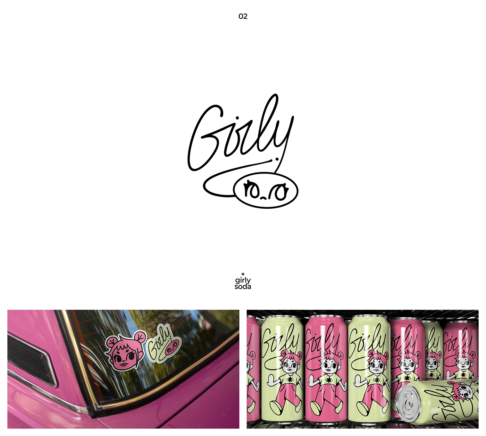

# Hand-scribbled 'Girly' signature with speech-bubble face, a doll mascot and pink and lime soda cans

**Discipline:** branding · **Design type:** Packaging and print collateral
**Tags:** logo, script, hand-drawn, mascot, packaging, soda, pink, lime

## What it is
A white slide with a loose single-line script 'Girly' whose tail loops around an oval with a tiny face, then two photos: die-cut stickers of the mascot and script on a pink car window, and a fridge of pink and lime cans with a doll-like character in a pink jumpsuit.

## What it means
Cheeky and youthful; scribbled lettering and a big-eyed doll feel like a zine drink.

## Techniques
- Write the logo as a fast single-line scribble.
- Tuck a face into the flourish.
- Alternate pink and lime pack colours.
- Use die-cut stickers as merch.

## Best for
- Beverage and youth brands
- Hand-drawn identities
- Sticker and packaging systems

## Vocabulary
- **Scribble script** — Loose handwritten lettering.
- **Flourish face** — A face hidden in a logo's tail.
- **Can wrap** — Artwork printed around a beverage can.
- **Die-cut sticker** — A sticker cut to the shape of its art.
