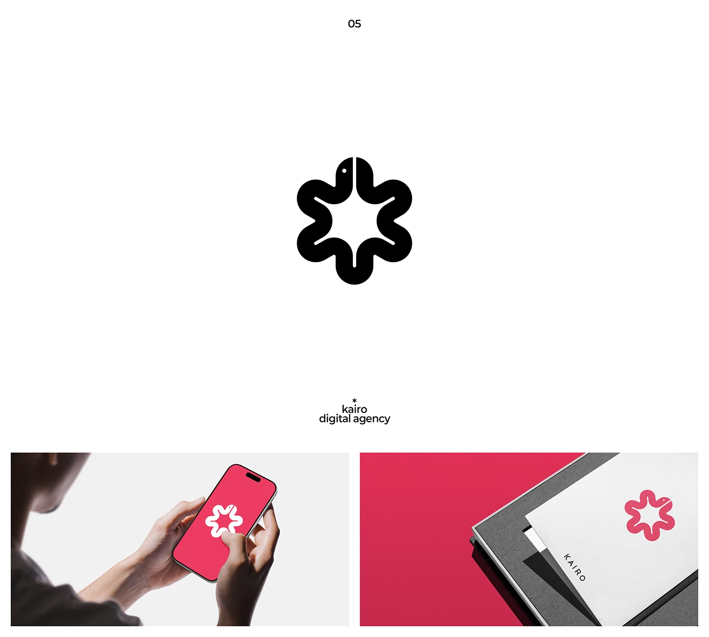

# Black snake-loop flower symbol reversed on a coral phone and printed on a folder

**Discipline:** branding ·  · **Design style:** Dark & Neon
**Tags:** logo, symbol, snake, flower, black, coral, stationery, hidden-animal

## What it is
A white slide with a large black symbol where one continuous snake bends into a six-lobed flower with a tiny eye at its head, a small caption 'kairo digital agency', and two photos: hands holding a coral phone with a white version, and a coral version on a white folder on grey.

## What it means
Clever and lively; a single animal loop becomes a flower, and coral makes it warm.

## Techniques
- Form a symbol from one looping creature.
- Add a tiny eye as the only detail.
- Show black, white-on-coral and coral-on-white versions.
- Photograph on grey stationery.

## Best for
- Digital agencies and startups
- Hidden-animal marks
- Marks needing colour flexibility

## Vocabulary
- **Continuous form** — A shape drawn as one unbroken loop.
- **Hidden animal** — An animal concealed inside a symbol.
- **Colour reversal** — Switching foreground and background colours.
- **Stationery mockup** — A folder or card presenting a logo.
