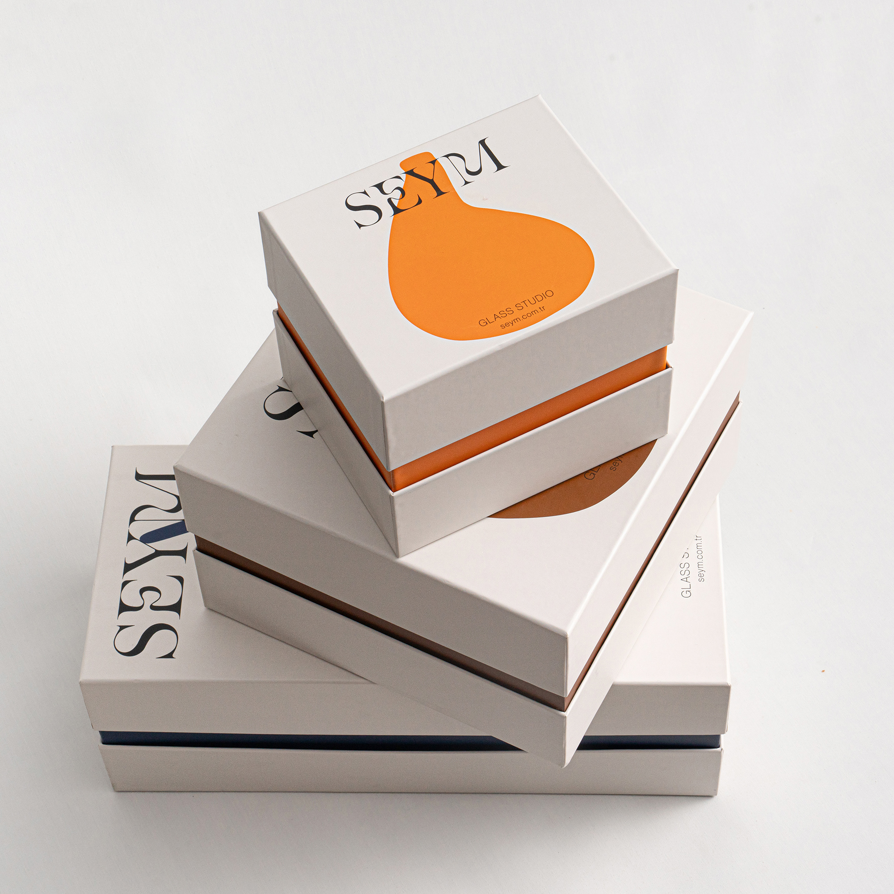

# SEYM glass studio gift boxes stacked, with a flat orange vase silhouette and a high-contrast serif wordmark

**Discipline:** branding · **Design type:** Packaging and print collateral · **Design style:** Minimalist
**Tags:** packaging, gift-box, orange, serif, glass-studio, stack

## What it is
Three off-white rigid lid boxes stacked at angles on white: the top box carries a big flat orange vase silhouette with the 'SEYM' serif wordmark crossing its neck, the others show the wordmark rotated along the lid, and each box reveals a coloured inner rim (orange, copper, navy).

## What it means
Crafted and gallery-like; one flat shape stands for the whole product, while coloured rims add a quiet surprise.

## Techniques
- Reduce the product to one flat silhouette on the lid.
- Let the wordmark cross the silhouette for integration.
- Colour the inner tray so the rim peeks out.
- Rotate the wordmark on larger boxes to vary the family.

## Best for
- Craft and homeware brands
- Premium gift packaging
- Studio identities

## Vocabulary
- **Rigid box** — A sturdy two-piece lid-and-base box.
- **Silhouette** — A solid shape showing only an outline.
