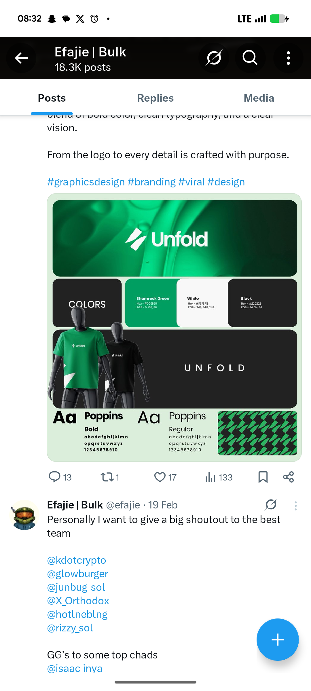

# Shamrock Green Unfold Brand Board

**Discipline:** branding ·  · **Design style:** 3D & Surreal
**Tags:** brand-board, green, black, mannequin, t-shirts, poppins, pattern, logo

## What it is
A social post of a mint-framed brand board with a green gradient banner holding a slashed-arrow mark and 'Unfold' wordmark, a Colors tile beside Shamrock Green, White and Black swatches with hex and RGB, a black tile with wide-tracked UNFOLD behind two mannequins in green and black tees, Poppins Bold and Regular specimens and a green and black zigzag pattern.

## What it means
A bold green with black and a chunky pattern makes a compact system, and mannequin tees prove the mark on apparel.

## Techniques
- Bento layout of banner, colours, merch, type and pattern
- Mannequins overlapping a tile edge
- Wide-tracked wordmark on black
- Zigzag pattern derived from the logo slash
- Swatches with hex and RGB values

## Best for
- Brand identity showcases on social
- Apparel-led identities
- Bento brand boards

## Vocabulary
- **Derived pattern** — A repeating graphic built from part of the logo.
- **Mannequin mockup** — Clothing shown on a faceless mannequin.
- **Wide tracking** — Extra space between letters.
