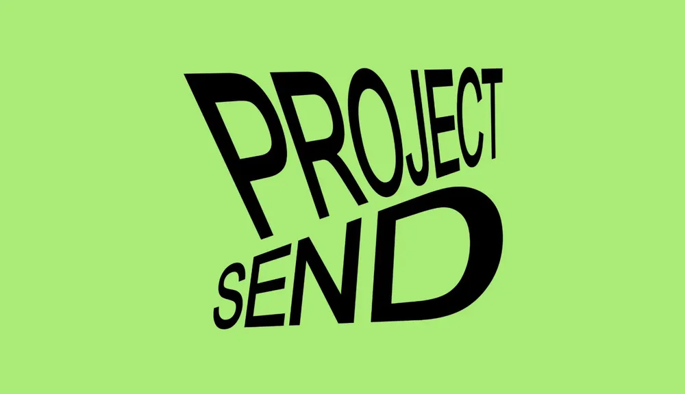

# Heavy black 'PROJECT SEND' set in a stretched, skewed perspective on flat lime green

**Discipline:** branding ·  · **Design style:** Dark & Neon
**Tags:** wordmark, warped-type, lime, black, perspective, heavy-sans, stacked, expressive

## What it is
A flat light lime field with a black wordmark in two lines, 'PROJECT' large and 'SEND' below, where the letters are stretched and skewed as if seen in perspective, with D much larger than the others and slightly rotated.

## What it means
Energetic and urgent; warped scale makes the word feel like it is being thrown forward.

## Techniques
- Warp heavy letters in perspective.
- Vary scale across letters.
- Stack two lines with tight spacing.
- Use black on one bright colour.

## Best for
- Campaign and event wordmarks
- Expressive type logos
- Bold two-colour identities

## Vocabulary
- **Perspective warp** — Type distorted as if viewed at an angle.
- **Scale contrast** — Letters of very different sizes in one word.
- **Stacked wordmark** — A name set on two lines.
- **Flat colour ground** — A single solid background colour.
