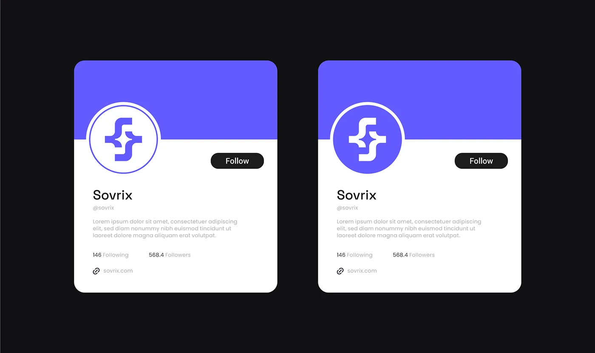

# Two profile cards on black: outlined and filled violet circle avatars over a violet half-banner with a Follow pill

**Discipline:** branding · **Design type:** Brand application mockups
**Tags:** social-profile, avatar, violet, white, black, cards, follow-button, logo

## What it is
A black field with two rounded white cards each with a violet top half, a circular avatar holding the logo (violet on white, and white on violet), name, handle, bio, counts, link and a black Follow pill.

## What it means
Clean and practical; testing avatar versions shows how the mark sits in a circle.

## Techniques
- Test the logo in a circle in two colourways.
- Split the card into colour banner and white body.
- Overlap the avatar across the split.
- Use a black Follow pill.

## Best for
- Social profile mockups
- Avatar testing
- Two-colour identities

## Vocabulary
- **Avatar lockup** — A logo placed inside a circular profile picture.
- **Half-banner card** — A card with a coloured top and white body.
- **Follow pill** — A capsule button for following.
- **Colourway test** — Showing two colour versions of a logo.
