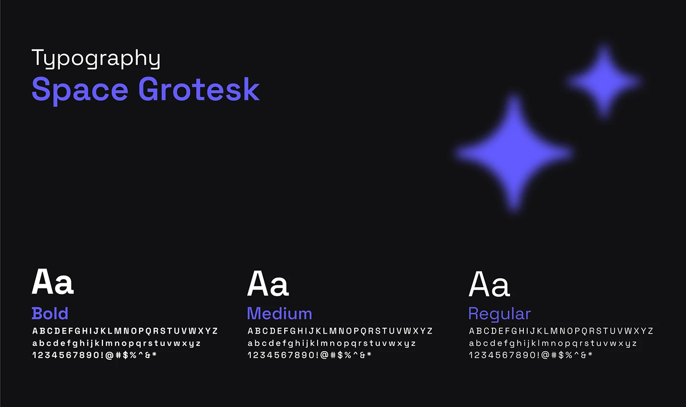

# Space Grotesk specimen in violet and white with blurred sparkle shapes

**Discipline:** branding · **Design type:** Typography and colour guide
**Tags:** typography, specimen, dark, violet, sparkle, weights, brand-guidelines, ai

## What it is
A near-black slide titled 'Typography' with the typeface name in violet, two blurred four-point sparkles at upper right, and three columns showing Aa in Bold, Medium and Regular with full alphabets and numerals.

## What it means
Techy and clean; sparkles signal AI while the specimen stays clear and orderly.

## Techniques
- Colour the type name in the brand accent.
- Show three weights side by side with alphabet lines.
- Use blurred sparkle shapes as an AI motif.
- Keep everything on a flat near-black canvas.

## Best for
- Brand guidelines for AI and tech products
- Type specimen pages
- Dark-mode design systems

## Vocabulary
- **Specimen** — A display of a typeface showing its characters.
- **Weight set** — Regular, medium and bold versions of one family.
- **Sparkle motif** — A four-point star used to suggest AI.
- **Accent name** — The font name coloured in the brand hue.
