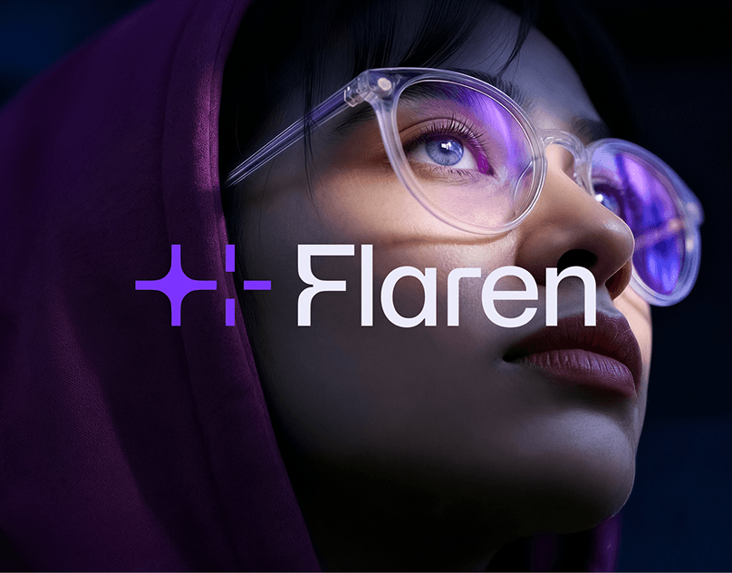

# Violet four-point sparkle with dashed square and white wordmark over a lit portrait, small crop

**Discipline:** branding ·  · **Design style:** Photographic & Cinematic
**Tags:** logo, symbol, sparkle, violet, dark-photo, portrait, ai, wordmark

## What it is
A dark violet-lit close portrait of a woman with clear glasses looking up. A violet sparkle beside a dashed vertical and horizontal bracket forms a symbol, followed by a white geometric wordmark 'Flaren'.

## What it means
Futuristic and human; sparkle and viewfinder marks suggest AI focus.

## Techniques
- Combine a sparkle and crosshair for a tech mark.
- Overlay a white wordmark on a dark portrait.
- Match the photo's light to the brand violet.
- Use a rounded geometric sans.

## Best for
- AI brands
- Photo-led identity covers
- Violet tech brands

## Vocabulary
- **Sparkle mark** — A four-point star used to signal AI.
- **Crosshair bracket** — Dashed lines forming a viewfinder.
- **Photo-tinted brand** — Photography graded in the brand colour.
- **Portrait overlay** — A wordmark placed over a face photo.
