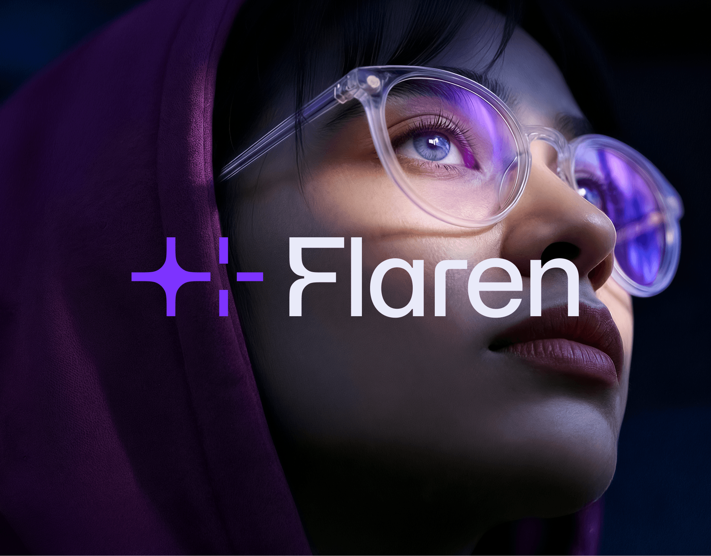

# Violet sparkle-crosshair symbol and 'Flaren' wordmark over a high-resolution portrait

**Discipline:** branding · **Design type:** Logo with symbol
**Tags:** logo, symbol, sparkle, violet, dark-photo, portrait, ai, wordmark

## What it is
A full-size version of the cover: a woman in a plum hood and clear round glasses gazes upward in violet light, with the sparkle symbol and white 'Flaren' wordmark across the centre.

## What it means
Cinematic and focused; the glasses reflect the brand colour.

## Techniques
- Let reflective props (glasses) carry brand colour.
- Place the lockup across the face's midline.
- Use dark photo edges to frame.
- Set the wordmark in soft white.

## Best for
- AI and tech launches
- Cinematic brand covers
- Portrait-led identities

## Vocabulary
- **Reflective prop** — An object reflecting the brand colour.
- **Cinematic grade** — Colour treatment like a film still.
- **Midline lockup** — A logo centred across the middle.
- **Soft white** — A slightly tinted white for text.
