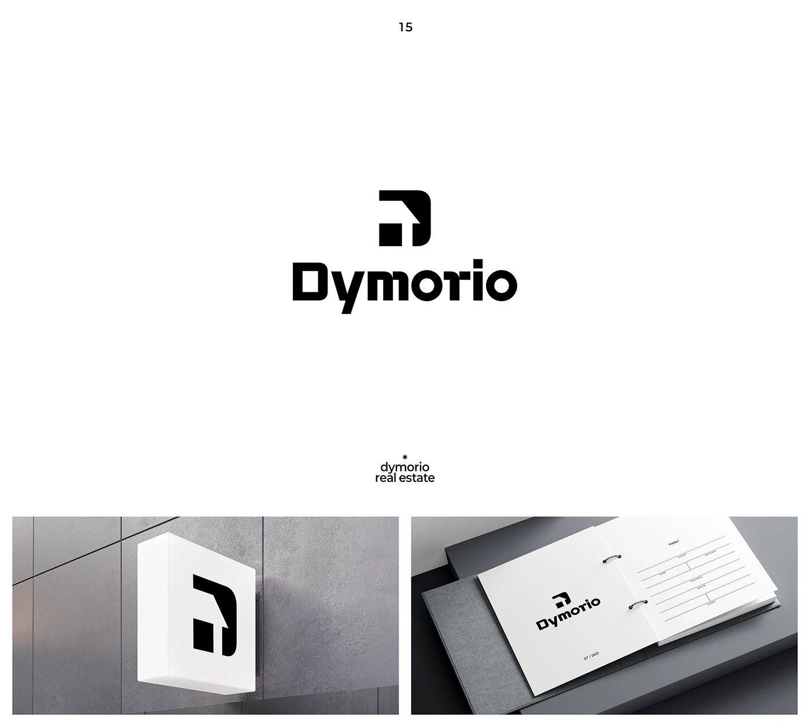

# Blocky D with cut-out square forming a house, on signage and a ring binder

**Discipline:** branding · **Design type:** Logo with symbol
**Tags:** logo, symbol, real-estate, black-and-white, geometric, signage, binder, wordmark

## What it is
A white slide with a black symbol where a D shape has a square notch and a roof-like arrow, over a heavy squared wordmark 'Dymorio'. Below: a white light-box sign with the mark on grey stone, and a ring binder with the logo on a form page.

## What it means
Solid and modern; a house and a D in one shape suit property and stability.

## Techniques
- Hide a house silhouette inside a letterform.
- Choose a squared heavy typeface to echo the symbol.
- Show the mark on architectural signage and paperwork.
- Stay black and white on cool grey.

## Best for
- Real-estate and property brands
- Brands using an initial plus pictogram
- Corporate identity presentations

## Vocabulary
- **Hidden pictogram** — A symbol concealed within a letter.
- **Squared type** — Letters with rectangular geometry.
- **Wall sign** — A projecting sign mounted on a wall.
- **Form page** — A ruled paper mockup showing stationery use.
