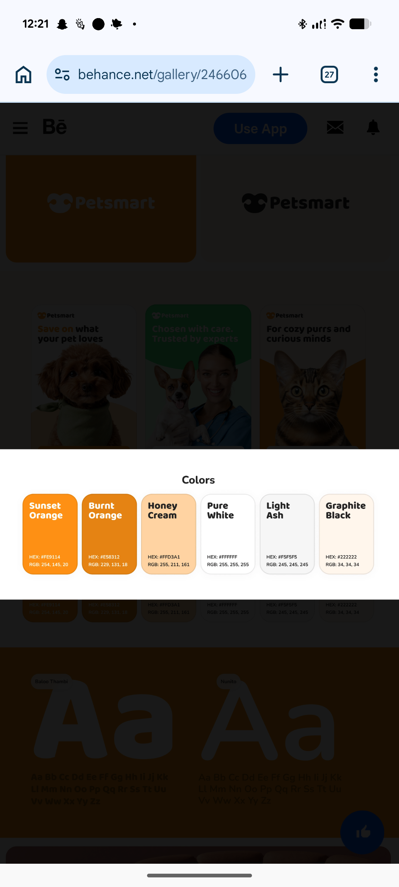

# Sunset Orange and Honey Cream Palette Cards

**Discipline:** branding ·  · **Design style:** Warm & Organic
**Tags:** palette, orange, cream, white, ash, graphite, rounded-cards, hex-rgb

## What it is
A white palette panel titled Colors with six tall rounded cards: Sunset Orange, Burnt Orange, Honey Cream, Pure White, Light Ash and Graphite Black, each with a bold name at the top and hex and RGB values at the bottom, over a dimmed case-study page with a logo tile and Aa type specimens.

## What it means
Named swatches with both hex and RGB values are practical and warm, and orange with cream feels friendly.

## Techniques
- Tall rounded swatch cards with names top-left
- Hex and RGB values at the card base
- Warm orange ramp from bright to burnt
- Neutrals (white, ash, graphite) completing the set
- Palette shown between logo and type sections

## Best for
- Brand colour documentation
- Friendly retail identities
- Palette slides with usable values

## Vocabulary
- **Named swatch** — A colour sample with a descriptive name.
- **RGB value** — A colour written as red, green and blue numbers.
- **Neutral set** — White, grey and near-black colours supporting an accent.
