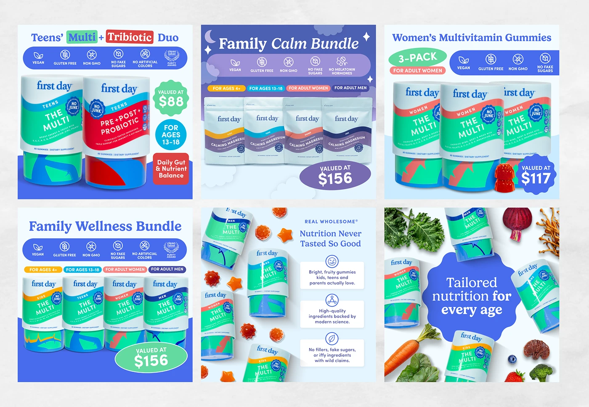

# Six listing images for gummy bundles with row icon badges, valued-at bubbles and colour-coded age tags

**Discipline:** branding · **Design type:** Product infographic set
**Tags:** e-commerce, listing-images, supplements, bundle, badges, blue, serif-title, packaging

## What it is
A 3x2 grid of listing images on blue and white: 'Teens' Multi + Tribiotic Duo', 'Family Calm Bundle', 'Women's Multivitamin Gummies', 'Family Wellness Bundle', a scatter shot of tubs and gummies with three benefit boxes, and 'Tailored nutrition for every age' inside a scalloped blue badge, each with a blue strip of icon badges (Vegan, Gluten Free, Non GMO, No Fake Sugars), tinted valued-at bubbles and colour-coded age pills.

## What it means
Clear and reassuring; icon rows and bubbles answer purchase questions at a glance.

## Techniques
- Line up icon badges in a blue strip.
- Use scalloped bubbles for price and age.
- Code age groups by colour.
- Set serif titles in blue.

## Best for
- Supplement e-commerce listing images
- Bundle and range pages
- Badge-based infographics

## Vocabulary
- **Icon badge strip** — A row of small claims with icons.
- **Valued-at bubble** — A scalloped bubble stating a price.
- **Age pill** — A colour-coded label for an age group.
- **Bundle image** — A picture showing several products together.
