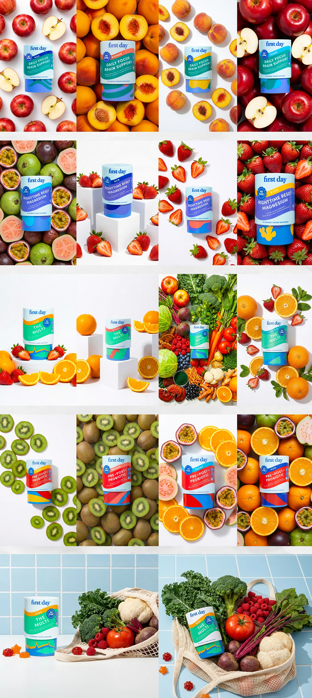

# Sixteen photos of teal and blue vitamin tubs on beds of apples, peaches, berries, kiwis and oranges, plus a veg bag

**Discipline:** branding · **Design type:** Campaign photography
**Tags:** photography, packaging, fruit, colour-block, supplements, flat-lay, grid, food-styling

## What it is
A grid of vertical photos each showing a tub of a different variant (focus, magnesium, multi, probiotic) nestled among the fruit it relates to on white or fruit-filled backgrounds, with blocks of white podiums, scattered slices and two shots with a mesh bag of vegetables on blue tile.

## What it means
Fresh and appetising; matching ingredient photography makes each flavour feel real.

## Techniques
- Style each variant with its own fruit.
- Alternate dense fruit beds and airy scatter.
- Add white podiums.
- Use a blue tile scene for veg.

## Best for
- Supplement and food packaging photography
- Variant range shots
- Ecommerce hero sets

## Vocabulary
- **Fruit bed** — A dense background of ingredients.
- **Scatter shot** — Ingredients scattered around a product on white.
- **Podium shot** — A product on white blocks.
- **Variant styling** — Different ingredients per product variant.
