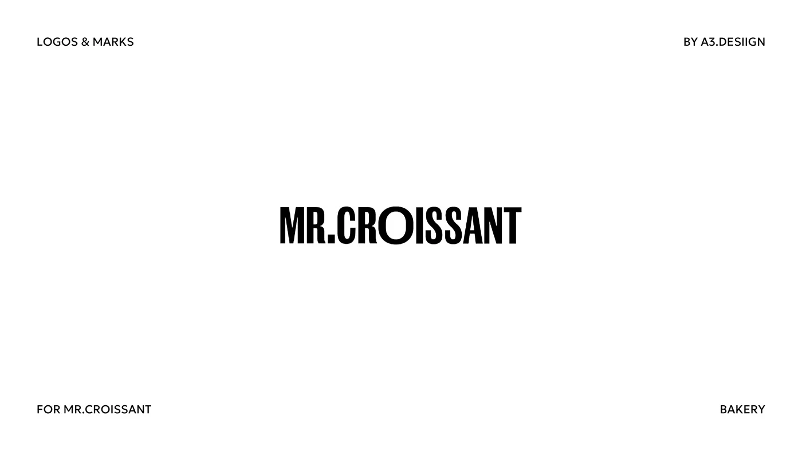

# Tall condensed black MR.CROISSANT wordmark with a round O

**Discipline:** branding ·  · **Design style:** Minimalist
**Tags:** wordmark, condensed, black-and-white, bakery, minimal, corner-labels, sans

## What it is
A white slide with corner captions and a single black condensed sans wordmark 'MR.CROISSANT' whose O is a round counter contrasting with tall narrow letters.

## What it means
Strong and simple; a tall narrow face feels like a shop sign.

## Techniques
- Use an ultra-condensed sans.
- Round the O as a small contrast.
- Keep the mark black on white.
- Use small corner captions.

## Best for
- Bakeries and cafés
- Simple type-only logos
- Signage-friendly wordmarks

## Vocabulary
- **Condensed sans** — A narrow, tall sans-serif.
- **Round counter** — A circular inner shape in a letter.
- **Type-only logo** — A logo made purely from lettering.
- **Corner captions** — Small labels in the four corners.
