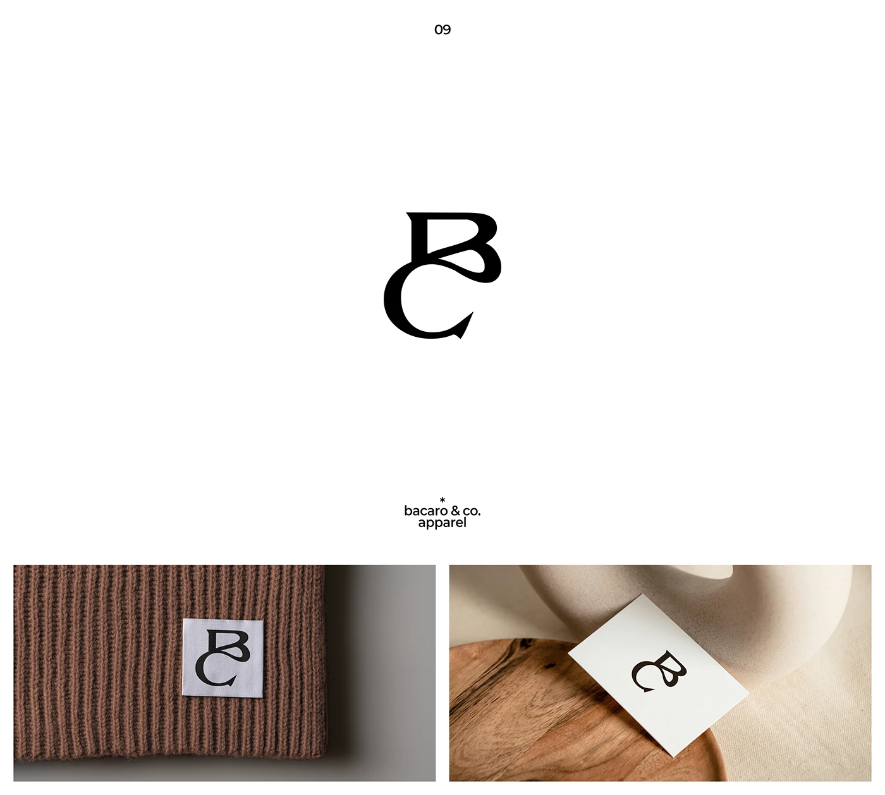

# Interlocking B and C serif monogram on a woven label and card

**Discipline:** branding · **Design type:** Logo with symbol
**Tags:** monogram, serif, calligraphic, apparel, woven-label, business-card, brown, minimal

## What it is
A white slide with a black monogram where a flared serif B sits over a C with a curved tail. Below, a small woven label with the mark stitched on a chocolate ribbed knit, and a cream card with the mark on a wooden plate beside a ceramic form.

## What it means
Refined and artisan; the curling terminals give a hand-drawn elegance.

## Techniques
- Interlock two initials vertically with shared curves.
- Use flared serif terminals for a boutique feel.
- Show the mark on a small woven label to prove small-size legibility.
- Photograph in warm neutrals with natural materials.

## Best for
- Fashion and apparel labels
- Boutique and artisan brands
- Serif monogram identities

## Vocabulary
- **Stacked monogram** — Initials arranged one above the other.
- **Flared terminal** — A stroke end that widens like a flame.
- **Woven label** — A fabric tag sewn into clothing.
- **Natural-material styling** — Props like wood and ceramics used to add warmth.
