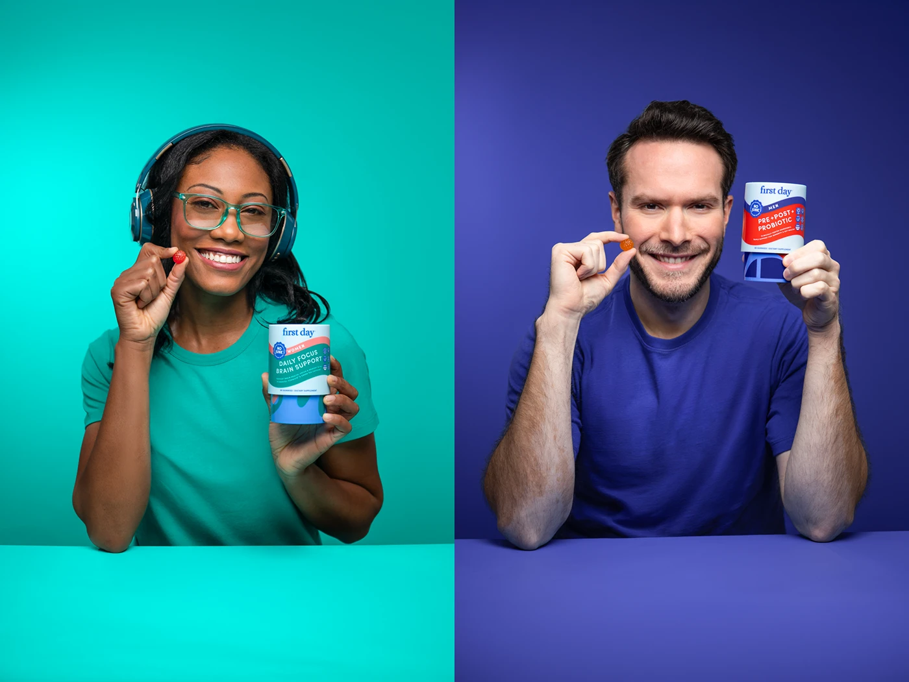

# Woman in teal and man in indigo on matching backdrops each holding a gummy and a tub

**Discipline:** branding · **Design type:** Campaign photography
**Tags:** photography, portrait, teal, indigo, gummies, split-frame, packaging, studio

## What it is
A split image with a smiling woman in headphones and glasses in teal on a teal backdrop and a smiling bearded man in an indigo tee on indigo, each pinching a gummy near the face and holding a tub of their product line.

## What it means
Upbeat and inclusive; head-to-toe colour matching turns each person into a brand swatch.

## Techniques
- Match clothing, backdrop and pack accent colours.
- Repeat the same pose in both frames.
- Use a gummy near the smile as a focal detail.
- Place the table edge as a horizontal base.

## Best for
- Supplement and wellness campaigns
- Audience-segment ads
- Colour-block portrait series

## Vocabulary
- **Colour matching** — Clothing and backdrop in one hue.
- **Pose repeat** — The same gesture in every frame of a set.
- **Segment visual** — An image tailored to one audience.
- **Table base** — A flat surface line anchoring a portrait.
