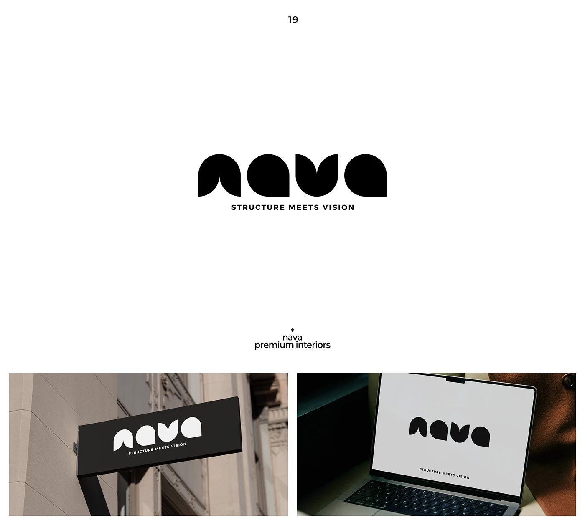

# Bulbous geometric 'nava' wordmark with 'Structure meets vision' tagline, on a dark sign and laptop

**Discipline:** branding ·  · **Design style:** Geometric & Bauhaus
**Tags:** wordmark, geometric, rounded, black-and-white, interiors, sign, laptop, tagline

## What it is
A white slide with a black lowercase wordmark where each letter is built from quarter-circles and teardrops with pointed corners, a wide-tracked caps tagline and two photos: a dark projecting sign on a stone wall and the mark on a laptop screen.

## What it means
Confident and architectural; soft curves with sharp points feel like designed rooms.

## Techniques
- Build letters from quarter-circle modules.
- Leave one sharp corner per curve for character.
- Add a tracked caps tagline.
- Show reversed on a dark sign.

## Best for
- Interior design and architecture studios
- Geometric wordmarks
- Signage-ready logos

## Vocabulary
- **Module lettering** — Letters made from repeated shapes.
- **Sharp corner** — A single pointed corner on a rounded form.
- **Tracked tagline** — Small caps with wide spacing.
- **Projecting sign** — A sign mounted perpendicular to a wall.
