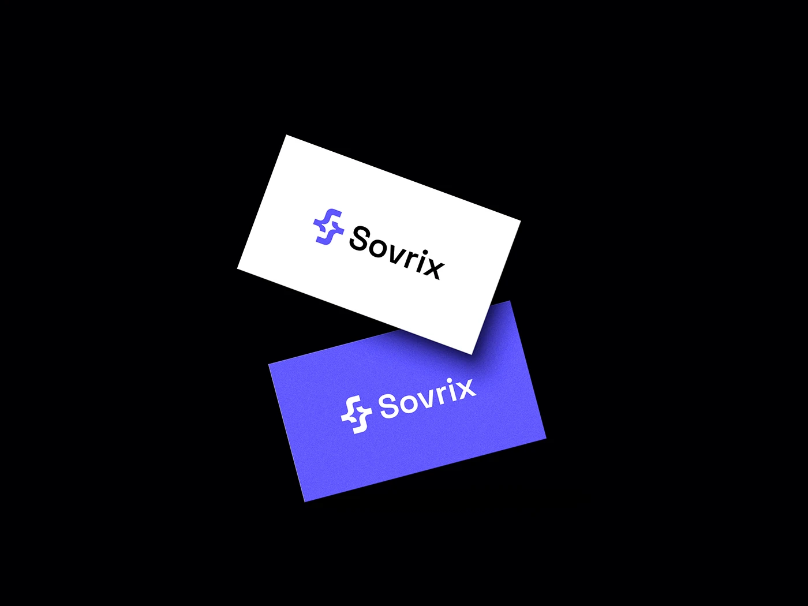

# Two floating business cards, white and violet, on a black field

**Discipline:** branding ·  · **Design style:** Minimalist
**Tags:** business-cards, violet, white, black, floating, monogram, minimal, tech

## What it is
On pure black, two cards float at angles, one white with a violet monogram and black wordmark, and one violet with the mark and name in white.

## What it means
Clean and modern; a colour reversal shows the identity's range simply.

## Techniques
- Float two colourways of a card at opposing angles.
- Use a black stage.
- Keep the layout centred and minimal.
- Add subtle grain on the coloured card.

## Best for
- Stationery previews
- Tech startup identities
- Simple two-colour marks

## Vocabulary
- **Floating mockup** — Objects suspended at angles without a surface.
- **Colourway** — A colour variation of the same design.
- **Reverse version** — The logo in white on colour.
- **Black stage** — A plain black background.
