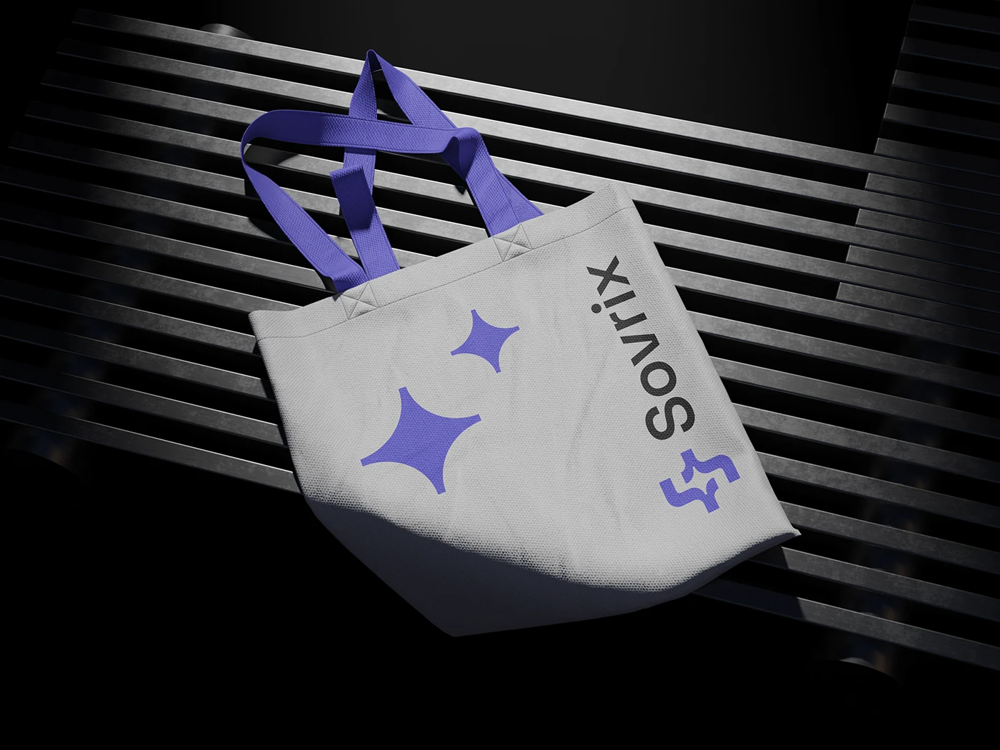

# Grey tote with violet handles, two violet sparkles and a vertical logo on dark metal slats

**Discipline:** branding ·  · **Design style:** Dark & Neon
**Tags:** tote, merch, violet, grey, sparkles, vertical-logo, dark-slats, hard-light

## What it is
A grey canvas tote with violet handles lies on a dark slatted surface in hard directional light, printed with two violet four-point sparkles and the rotated Sovrix logo along the right edge.

## What it means
Modern and playful; sparkles add personality to a technical mark.

## Techniques
- Print a sparkle motif as a secondary graphic.
- Rotate the logo along an edge.
- Match handles to the brand violet.
- Light with hard shadows.

## Best for
- Tech merchandise
- Brand extension graphics
- Tote bag identity

## Vocabulary
- **Secondary motif** — A supporting graphic used with the logo.
- **Vertical lockup** — A logo rotated 90 degrees.
- **Accent handle** — A coloured strap on a bag.
- **Hard light** — Direct light with sharp shadows.
