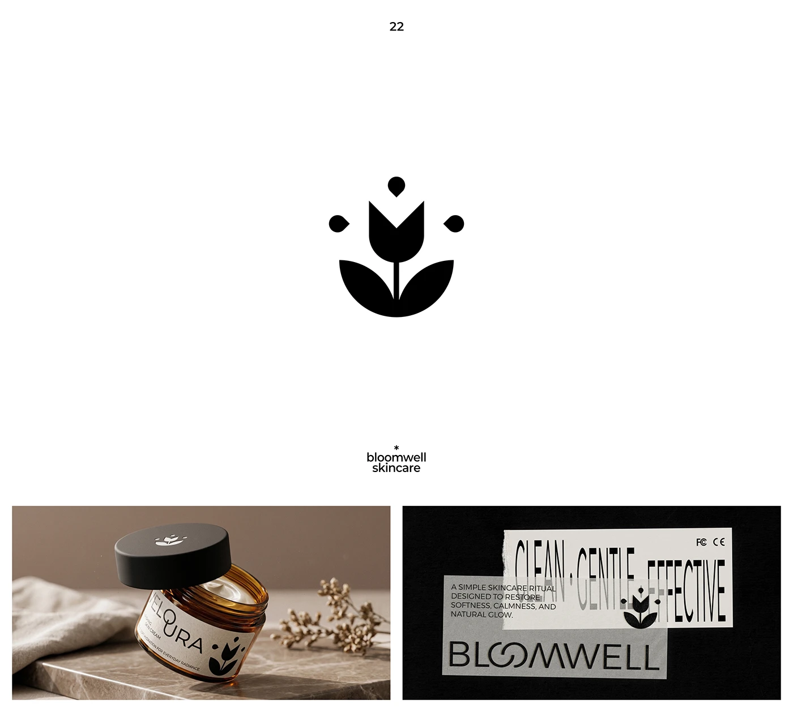

# Geometric tulip mark with droplets on an amber jar and taped condensed slogan

**Discipline:** branding ·  · **Design style:** Glassmorphism
**Tags:** logo, symbol, tulip, skincare, amber-glass, tape, condensed-type, black-and-white

## What it is
A white slide with a black tulip built from a folded bloom, two leaf halves and three droplets. Below: an amber glass jar with a black lid bearing the mark on warm stone, and a black sheet with translucent tape strips carrying the tall slogan 'CLEAN · GENTLE · EFFECTIVE' and an outline wordmark.

## What it means
Clean, soft and crafted; the symmetrical flower suggests care and growth.

## Techniques
- Build a flower from a few geometric shapes plus droplets.
- Print on amber glass to make a warm product photo.
- Overlay translucent tape strips with tall condensed slogan text.
- Stay black and white on natural surfaces.

## Best for
- Skincare and wellness identities
- Symbols that must work small
- Packaging and label systems

## Vocabulary
- **Droplet accent** — Small teardrop shapes added around a symbol.
- **Amber glass** — Brown-tinted glass used for cosmetics.
- **Tape overlay** — Translucent tape strips used as a graphic layer.
- **Condensed slogan** — A tagline in tall narrow letters.
