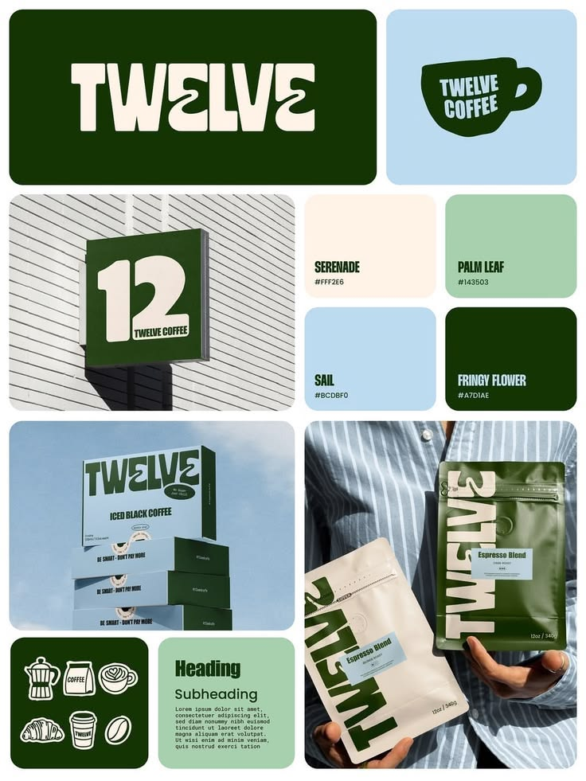

# Twelve Coffee Brand Board

**Discipline:** branding ·  · **Design style:** Warm & Organic
**Tags:** coffee, green, cream, sky-blue, wordmark, packaging, signage, icons

## What it is
A bento brand board for a coffee brand with a deep green tile and a wobbly cream wordmark, a mug-shaped logo on sky blue, a sign with a big 12, four colour swatches (Serenade, Palm Leaf, Sail, Fringy Flower), stacked iced coffee boxes against the sky, a person holding cream and green coffee bags with sideways wordmarks and an icon and type tile.

## What it means
A wavy chunky wordmark and a green, cream and sky palette feel playful yet premium, and the board shows the mark on sign, box and bag.

## Techniques
- Wavy chunky wordmark with a mirrored letter
- Green, cream and sky blue palette with named swatches
- Wordmark used vertically on bags
- Icon set of coffee objects in cream on green
- Photography of signage and packaging in a bento

## Best for
- Food and beverage brands
- Café identities
- Bento brand presentation boards

## Vocabulary
- **Wobbly wordmark** — Lettering with wavy distorted forms.
- **Signage mockup** — A logo shown on a shop sign.
- **Icon set** — A family of simple drawings in one style.
