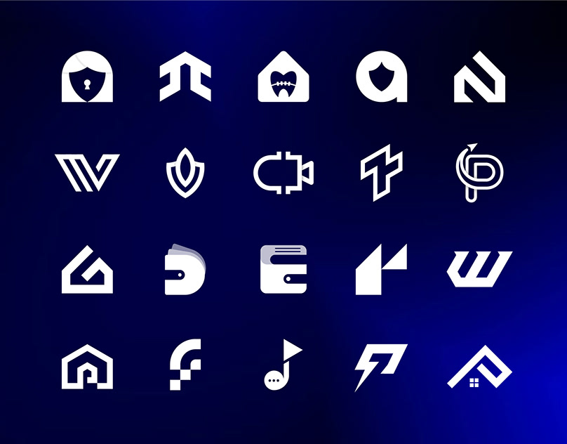

# Twenty white icon-style logos on a navy field with a blue glow

**Discipline:** branding · **Design type:** Logo collection
**Tags:** logo-collection, white-on-navy, icons, geometric, negative-space, house, letters, grid

## What it is
A 5x4 grid of white symbols on a dark navy background with a blue glow at the lower right: a padlock face, arrows, tooth house, shield A, letter marks, leaf shield, wallet, music note, lightning bolt, houses and more, all built from simple geometry and negative space.

## What it means
Crisp and versatile; white marks on a glow show the range of a logo designer.

## Techniques
- Show all marks reversed on one dark field.
- Use negative space to hide a second meaning in each mark.
- Keep uniform size and spacing.
- Add a coloured glow for depth.

## Best for
- Logo portfolio overviews
- Icon-style mark collections
- Designer self-promotion

## Vocabulary
- **Dual-meaning mark** — A logo containing two ideas in one shape.
- **Reversed mark** — A logo in white on a dark field.
- **Icon grid** — An evenly spaced set of icons.
- **Ambient glow** — A soft coloured bloom in the background.
