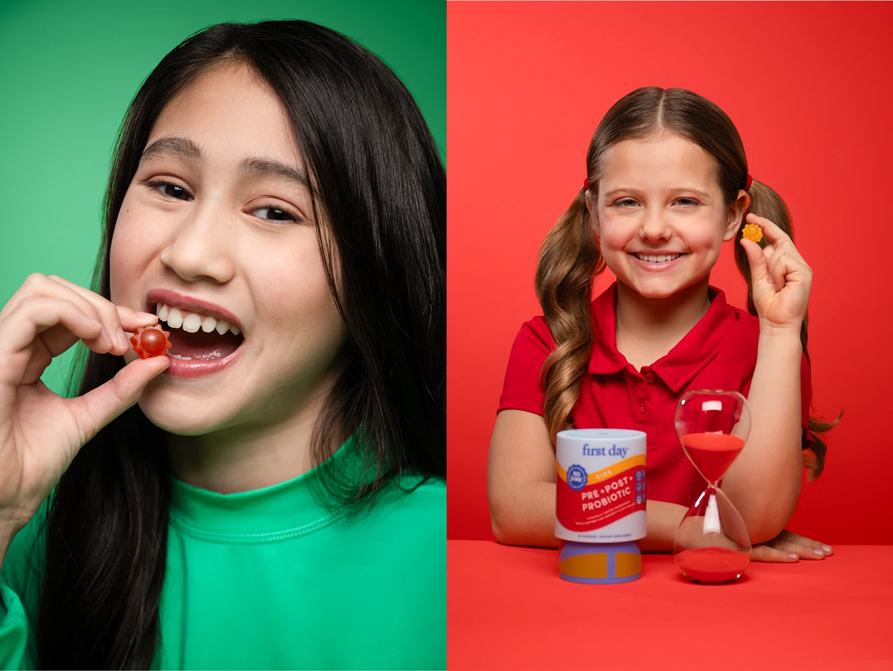

# Two colour-block portraits: girl biting a gummy on green, girl with tub and hourglass on red

**Discipline:** branding · **Design type:** Campaign photography
**Tags:** photography, portrait, green, red, gummies, split-frame, kids, studio

## What it is
A split image: at left a close portrait of a girl in green biting a red gummy on a green backdrop; at right a smiling girl in a red polo holding a gummy beside a tub and a red-sand hourglass on a red backdrop.

## What it means
Bold and joyful; matching outfits and backdrops make the child part of the palette.

## Techniques
- Match clothing to a flat backdrop.
- Use tight expressive close-ups.
- Add a symbolic prop (hourglass).
- Split the frame in two colours.

## Best for
- Children's product campaigns
- Colour-block portraiture
- Supplement brands

## Vocabulary
- **Tone-on-tone portrait** — Subject clothing and backdrop in one hue.
- **Symbolic prop** — An object suggesting an idea like time.
- **Close crop** — A tight framing on the face.
- **Split frame** — Two images side by side.
