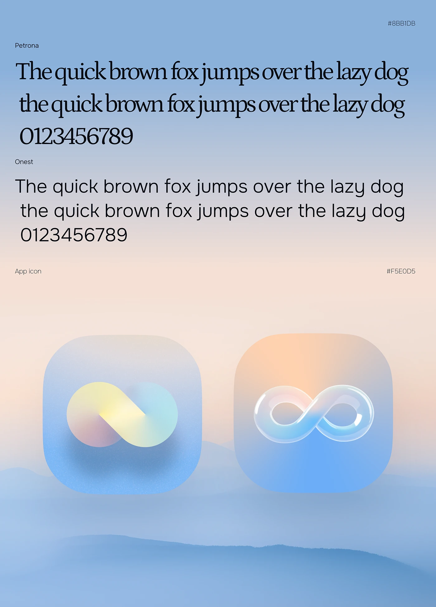

# Serif and sans type specimens above two glassy infinity app icons on a blue mountain mist

**Discipline:** branding · **Design type:** Typography and colour guide
**Tags:** typography, app-icon, glass, infinity, pastel, gradient, mist, petrona

## What it is
A blue-to-peach misty landscape with two specimen blocks (Petrona serif and Onest sans, each with pangram and numerals), hex codes, and two rounded-square app icons: a soft yellow, pink and blue infinity loop and a glossy translucent glass infinity on a peach-blue gradient.

## What it means
Calm and airy; soft gradients and glass suggest a gentle, limitless product.

## Techniques
- Pair a display serif with a plain sans.
- Show two icon treatments (flat gradient and glass).
- Use a misty gradient landscape as the page.
- Print hex codes in the corners.

## Best for
- Wellness and AI brand guides
- App icon explorations
- Pastel gradient identities

## Vocabulary
- **Glass icon** — An app icon with translucent glossy 3D form.
- **Pangram specimen** — A sample sentence containing every letter.
- **Misty gradient** — A soft landscape-like colour fade.
- **Infinity loop** — A figure-eight symbol.
