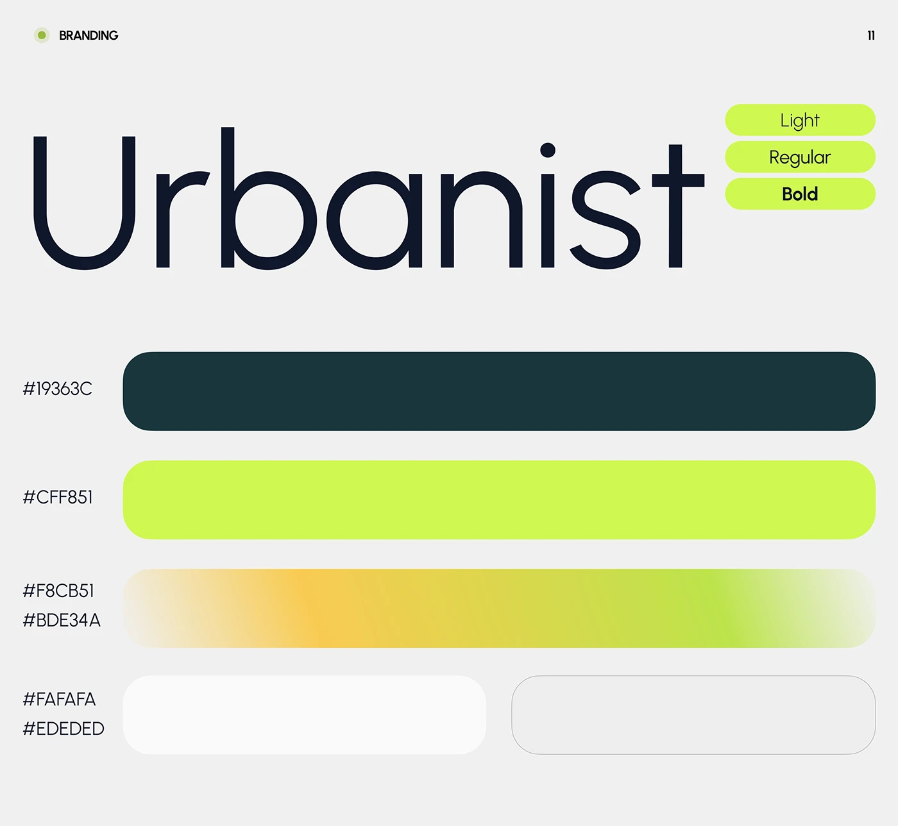

# Giant 'Urbanist' specimen with lime weight pills and stacked rounded colour bars in teal, lime and gradient

**Discipline:** branding · **Design type:** Typography and colour guide
**Tags:** typography, colour-palette, lime, dark-teal, pills, hex-codes, geometric-sans, brand-guidelines

## What it is
A pale grey sheet with a huge navy geometric sans 'Urbanist' with three lime pills (Light, Regular, Bold) and four long rounded colour bars labelled with hex codes: dark teal, lime, a warm yellow-to-green gradient, and two neutrals.

## What it means
Fresh and confident; big type and generous colour bars read as a calm system.

## Techniques
- Show the typeface at giant scale.
- List weights as lime pills.
- Stack colours as long rounded bars.
- Include a gradient swatch as a brand asset.

## Best for
- Brand guidelines
- Type and colour pages
- Lime-and-teal brands

## Vocabulary
- **Weight pill** — A capsule naming a font weight.
- **Colour bar** — A long rounded swatch labelled with its code.
- **Gradient swatch** — A swatch showing a colour blend.
- **Giant specimen** — A typeface name at huge size.
