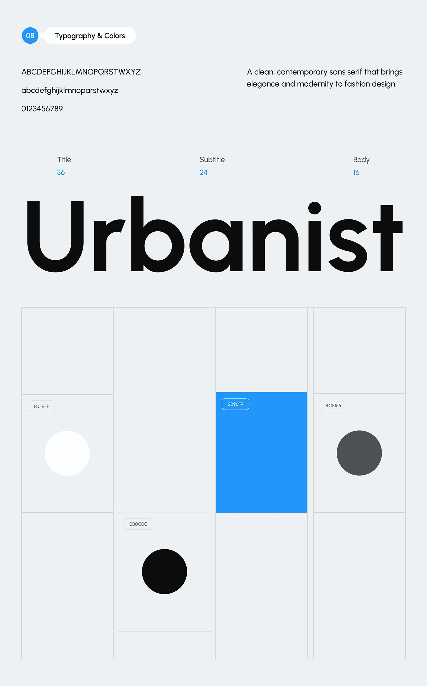

# Urbanist Specimen with Modular Colour Grid

**Discipline:** branding ·  · **Design style:** Minimalist
**Tags:** typography, specimen, colour-grid, blue, black, white, grey, hairlines

## What it is
A pale grey-blue slide with a numbered Typography & Colors pill, alphabet lines, a type scale (36, 24, 16), a giant black 'Urbanist' specimen and a grid of hairline cells in which four colours (white, black, blue, grey) appear as a circle or a filled cell with hex codes.

## What it means
Placing swatches on a hairline grid makes the palette feel architectural, and the huge word makes the typeface unmistakable.

## Techniques
- Hairline modular grid of unequal cells
- Colours shown as circles and one full cell
- Hex codes in outlined pills
- Giant one-word specimen
- Blue as the sole colour accent

## Best for
- Typography and colour slides
- Minimal brand documentation
- Modular layout inspiration

## Vocabulary
- **Modular grid** — A grid of cells of different sizes.
- **Hex pill** — An outlined label holding a colour code.
- **Type scale** — Sizes for title, subtitle and body.
