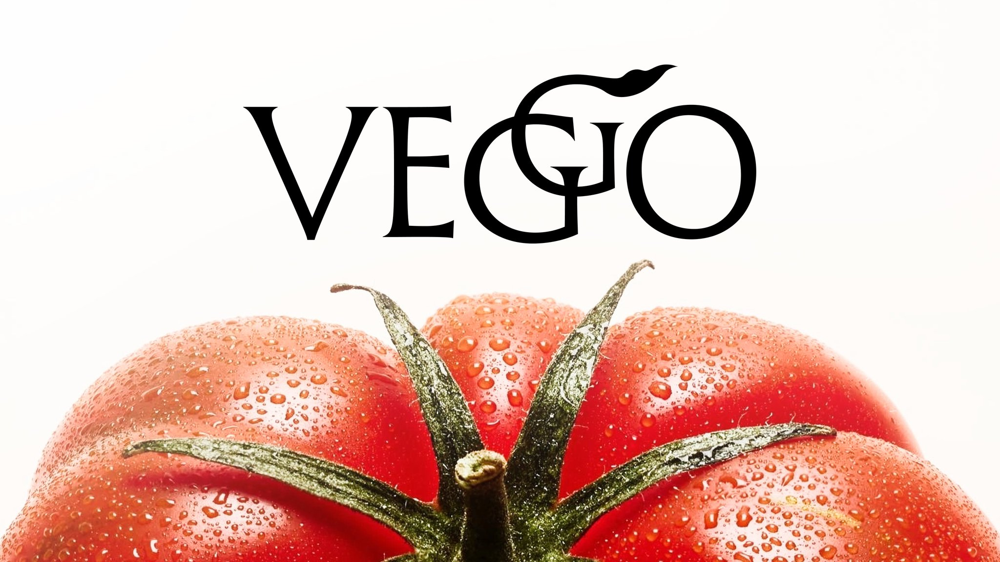

# High-contrast serif 'VEGO' with an oversized swash G over a close photo of a dewy heirloom tomato

**Discipline:** branding · **Design type:** Wordmarks
**Tags:** wordmark, serif, swash, tomato, photography, white, red, food

## What it is
A white field with a black flared serif wordmark 'VEGO' where the G is drawn larger with a leafy flourish overlapping the E and O, placed above a close-up photo of a red tomato with green calyx and water droplets cropped at the bottom.

## What it means
Fresh and elegant; the swash G feels like a vine tendril and the tomato proves freshness.

## Techniques
- Overlap an oversized swash letter onto neighbours.
- Pair a black serif with a saturated red photo.
- Crop the photo at the bottom.
- Keep the background white.

## Best for
- Fresh food and produce brands
- Serif wordmarks with a signature letter
- Photo-plus-logo covers

## Vocabulary
- **Swash letter** — A letter with a decorative flourish.
- **Flared serif** — A serif with widening strokes.
- **Macro produce** — A close photo of fruit or vegetables.
- **Overlapping letters** — Letters crossing into each other.
