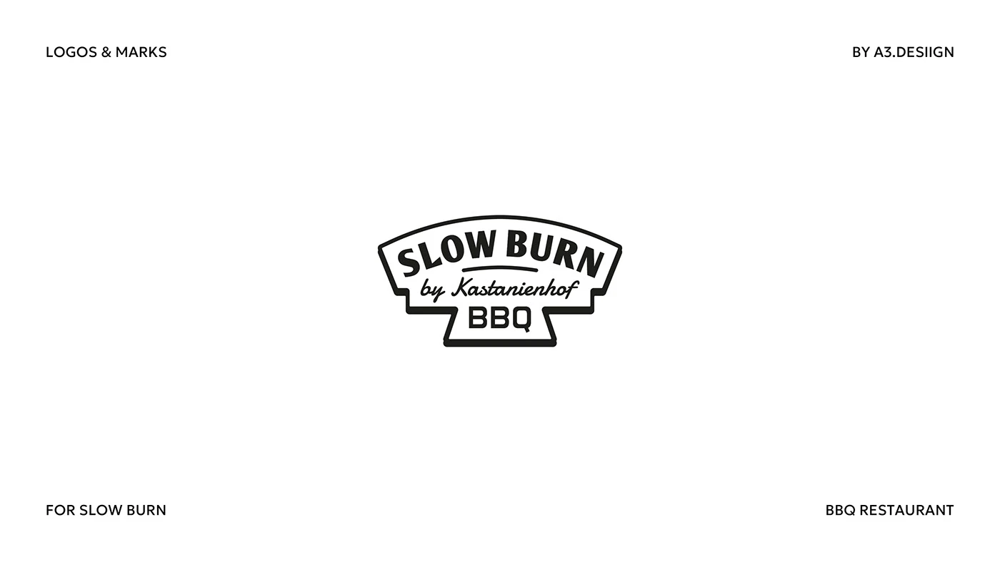

# Arched retro banner badge for a BBQ restaurant with slab lettering, script and drop shadow

**Discipline:** branding · **Design type:** Logo with symbol
**Tags:** badge, bbq, vintage, slab, script, banner-shape, black-and-white, restaurant

## What it is
A white slide with tiny caps labels and a black-and-white badge shaped like an arched banner with a stepped bottom tab. It reads 'SLOW BURN' in slanted slab caps, 'by Kastanienhof' in script and 'BBQ' in a square sans, with an offset shadow.

## What it means
Warm and smoky; classic signage cues say old-school barbecue.

## Techniques
- Shape the badge like a vintage sign banner.
- Layer slab, script and square sans.
- Add an offset shadow line.
- Keep it in one colour.

## Best for
- Restaurants and food trucks
- Retro badge logos
- One-colour signage

## Vocabulary
- **Banner badge** — A logo shaped like a signboard.
- **Slab caps** — Heavy serif capitals with square serifs.
- **Offset shadow line** — A shifted outline adding depth.
- **Type stack** — Multiple type styles layered in one lockup.
