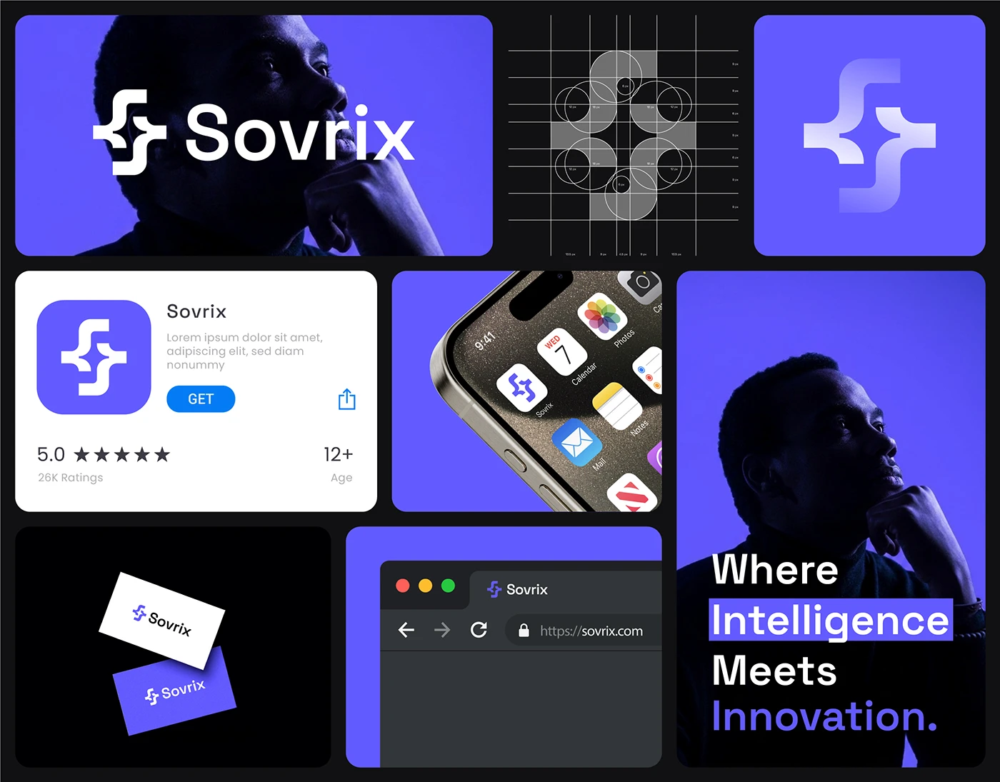

# Bento of violet tiles: logo over a silhouette, construction grid, gradient symbol, store card, home-screen icon, cards, browser and tagline

**Discipline:** branding · **Design type:** Brand collage board
**Tags:** brand-board, bento, violet, black, logo-construction, app-store, home-screen, tagline

## What it is
A black-framed grid of tiles: the white logo over a violet-toned profile portrait, a construction grid with circles, a large gradient-white symbol on violet, an App Store card with the icon and a blue GET, a phone corner with the icon among iOS apps, two floating business cards, a violet browser mockup and a tall portrait with highlighted tagline 'Where Intelligence Meets Innovation.'

## What it means
Cohesive and premium; one violet unites photo, UI and stationery.

## Techniques
- Build a bento of applications in one colour.
- Highlight tagline words with violet bars.
- Show construction and store views together.
- Alternate photo and flat tiles.

## Best for
- Tech brand identity boards
- Application overviews
- Violet-black identities

## Vocabulary
- **Bento brand board** — A tile grid of brand applications.
- **Store card** — An app listing tile.
- **Word highlight** — A bar behind chosen tagline words.
- **Duotone portrait** — A portrait in one colour plus black.
