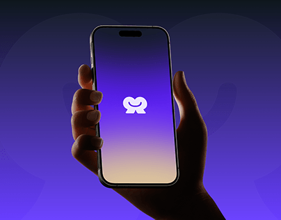

# White mirrored-smile logo on a violet-to-sand gradient phone screen held in a hand

**Discipline:** branding · **Design type:** Brand application mockups
**Tags:** logo, app-splash, violet, gradient, hand, phone, white-mark, dark-background

## What it is
A violet-to-indigo backdrop with faint giant shapes and a hand holding a phone whose screen fades from violet to sand with a white symbol of two connected rounded shapes forming a smile.

## What it means
Friendly and modern; the gradient screen makes a splash logo feel warm.

## Techniques
- Show the logo on a gradient splash screen.
- Match the backdrop to the screen colour.
- Hold the phone upright in a hand.
- Use giant faint logo shapes behind.

## Best for
- App identity presentations
- Splash and logo reveals
- Violet brands

## Vocabulary
- **Splash screen** — The first screen with only a logo.
- **Screen gradient** — A colour blend across the phone screen.
- **Faint backdrop shape** — A giant low-contrast form behind.
- **Hand mockup** — A device held by a hand.
