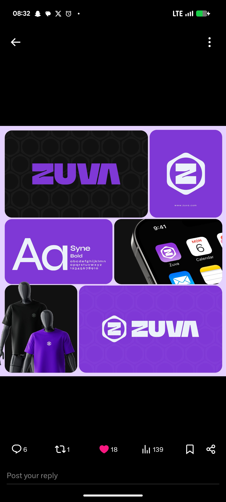

# Violet Hexagon Z Monogram Brand Board

**Discipline:** branding · **Design type:** Brand identity board
**Tags:** brand-board, violet, black, hexagon, monogram, syne, app-icon, tees

## What it is
A lilac-framed bento board of rounded tiles: a black tile with a violet wordmark on a hexagon pattern, a violet tile with a white Z inside a hexagon, a Syne Bold specimen, a phone corner with the gradient app icon among system icons, two mannequins in black and violet tees and a wide violet tile with the mark and wordmark in white.

## What it means
A single violet with black and a hexagon motif repeated across pattern, mark and icon gives an instantly recognisable set.

## Techniques
- Hexagon pattern reused as texture and shape
- Monogram inside a hexagon container
- Big Aa specimen with the typeface name
- App icon shown among system icons
- Tees showing the mark small on the chest

## Best for
- Tech and web3 brand boards
- Monogram identities
- Bento presentations

## Vocabulary
- **Motif repetition** — Reusing one shape across all brand assets.
- **Monogram** — A logo built from a single letter.
- **Icon in context** — An app icon displayed beside real system icons.
