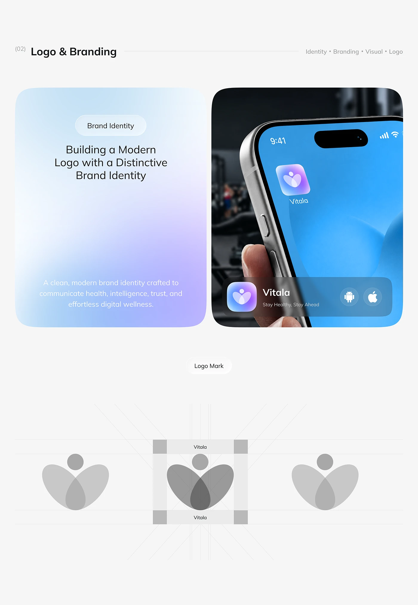

# Vitala Logo Mark, Grid and App Icon

**Discipline:** branding · **Design type:** Logo guidelines
**Tags:** logo, gradient, app-icon, construction, clear-space, health, blue

## What it is
A pale page titled Logo & Branding with a soft blue-to-lilac gradient card carrying a headline about building a modern logo, a dark photo tile of a finger tapping a gradient app icon on a blue home screen with an app-store style bar, and a Logo Mark section showing the greyscale petal-figure mark with clear-space guide lines.

## What it means
Showing the mark in grey with clear-space and a colour icon on a real home screen proves both structure and appeal.

## Techniques
- Gradient card with white text
- Macro phone with a finger about to tap the icon
- Grey mark shown with clear space guides
- Store-style bar with Android and Apple icons
- Fine radiating construction lines

## Best for
- Logo presentation pages
- Health-tech brand guidelines
- Logo plus home-screen mockup

## Vocabulary
- **Clear space guide** — Boxes marking the minimum empty area around a logo.
- **Petal-figure mark** — A logo of overlapping petals with a head shape.
- **Home-screen mockup** — An icon shown among apps on a phone.
