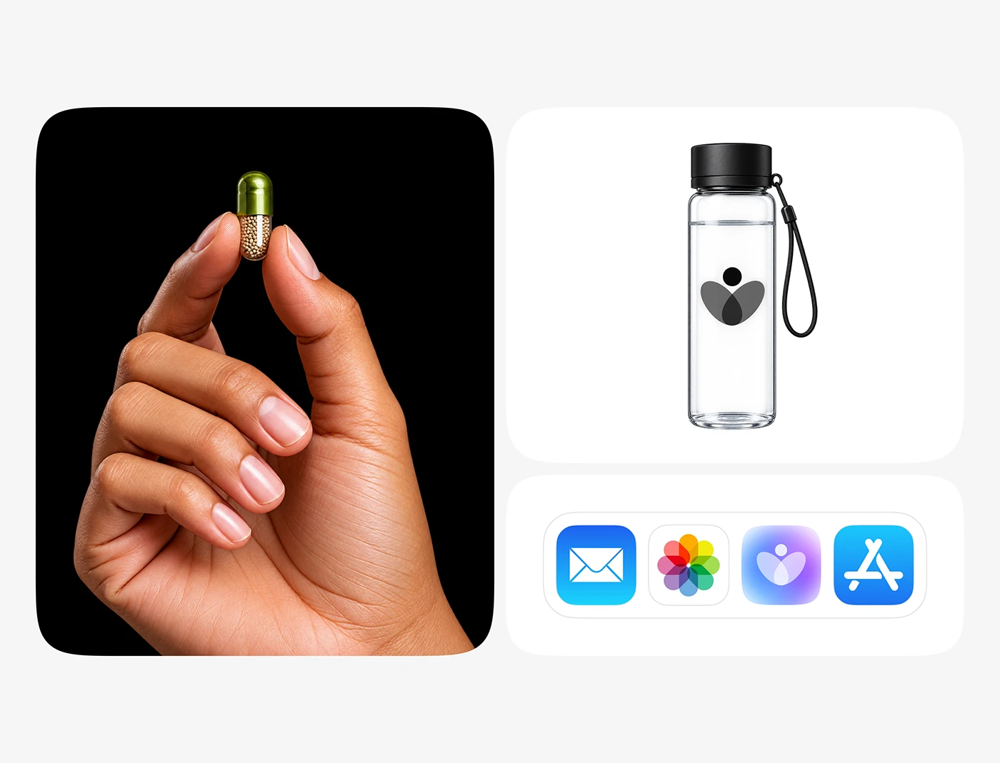

# Wellness Capsule, Bottle and App Icon Tiles

**Discipline:** branding ·  · **Design style:** Geometric & Bauhaus
**Tags:** wellness, capsule, bottle, app-icon, rounded-tiles, photography, black-white

## What it is
A three-tile board: a hand holding a green capsule on black, a clear bottle printed with a grey petal-person logo, and a row of home-screen icons including the brand's gradient icon.

## What it means
Contrasting a dramatic photograph with clean product shots communicates a health brand that spans physical and digital.

## Techniques
- Dark hero photo tile beside two clean white tiles
- Overlapping translucent petals in the logo forming a figure
- Logo shown on physical packaging and as an app icon
- System-native icons alongside to test fit
- Big rounded corners uniform across tiles

## Best for
- Health and wellness brands
- Identity presentations spanning product and app
- Supplement and pharma startups

## Vocabulary
- **Overlapping petals** — Translucent shapes overlapping to create blended tones.
- **Hero tile** — The largest tile in a board holding the boldest image.
- **Cross-medium application** — Showing one logo on both physical and digital surfaces.
