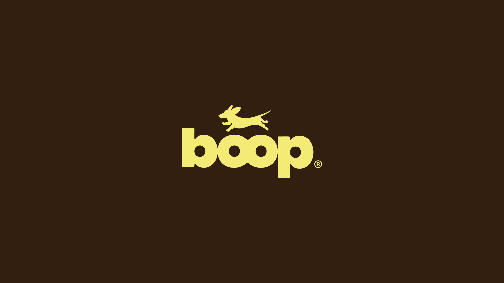

# Butter-yellow jumping dachshund silhouette above a fat lowercase 'boop' wordmark on dark chocolate brown

**Discipline:** branding ·  · **Design style:** Warm & Organic
**Tags:** logo, wordmark, dog, yellow, brown, silhouette, rounded, pet

## What it is
A dark chocolate brown field with a pale butter-yellow logo: a leaping dachshund silhouette above a heavy rounded lowercase wordmark 'boop' where the two Os are joined and the p has a long descender, followed by a small ®.

## What it means
Playful and warm; the dog leaping over the letters brings movement and personality.

## Techniques
- Perch a silhouette above a heavy wordmark.
- Join letters like the Os for a bone shape.
- Use a warm two-colour palette.
- Keep letterforms fat and rounded.

## Best for
- Pet brands
- Playful wordmarks with mascot
- Two-colour logos

## Vocabulary
- **Silhouette mascot** — An animal shown as a solid shape.
- **Joined letters** — Letters merged to form one shape.
- **Fat rounded type** — Heavy letters with soft corners.
- **Two-colour logo** — A logo in one colour on one background.
