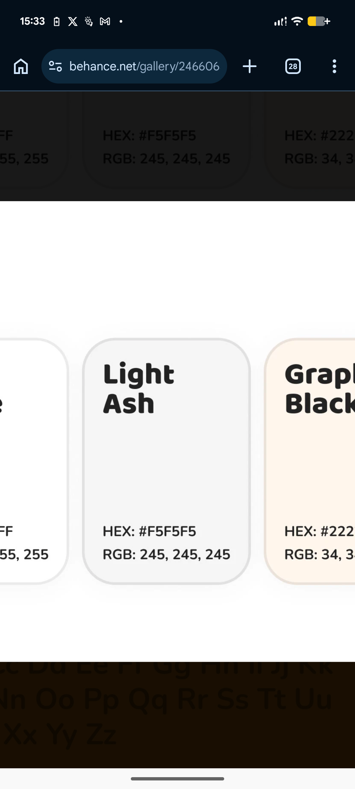

# Zoomed Light Ash and Graphite Swatch Cards

**Discipline:** branding ·  · **Design style:** Warm & Organic
**Tags:** palette, close-up, ash, graphite, rounded-cards, hex-rgb, zoom

## What it is
A zoomed-in view of the palette cards showing Light Ash in pale grey with an outline and Graphite Black in a warm cream card, each with a heavy name and hex and RGB values, over a dark page.

## What it means
Zooming into a swatch shows how big rounded corners and heavy names make colour information legible.

## Techniques
- Very large rounded corners on swatches
- Bold rounded sans names
- Hex and RGB values aligned bottom-left
- Soft outlines and shadows on light cards
- Text colour switched to suit each swatch

## Best for
- Colour card component references
- Detail views of palette layouts
- Rounded UI swatches

## Vocabulary
- **Swatch card** — A rounded card showing a colour and its values.
- **Zoomed detail** — An enlarged view of a small part of a layout.
- **Value block** — A pair of hex and RGB lines under a name.
