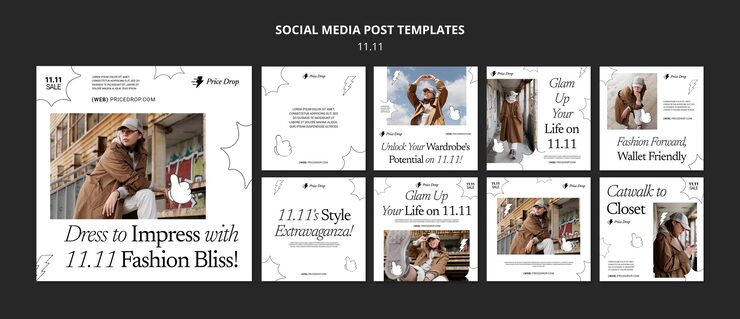

# 11.11 fashion sale pack with hand-drawn doodles, lightning bolts and italic serif headlines

**Discipline:** print-social · **Design type:** Social template pack · **Design style:** Editorial
**Tags:** fashion, sale, 11-11, doodles, serif, black-and-white, instagram

## What it is
Nine white square posts for an 11.11 'Price Drop' fashion sale: photos of a model in a brown coat, large mixed roman/italic serif headlines ('Dress to Impress with 11.11 Fashion Bliss!', 'Glam Up Your Life'), black outline doodles of hands, bursts and lightning bolts.

## What it means
Magazine serifs make a discount feel stylish; the scribbled doodles add energy and a zine-like wink.

## Techniques
- Mix upright and italic serif within one headline for rhythm.
- Scatter hand-drawn outline doodles around photos for energy.
- Keep a white field so warm-toned photos carry the colour.
- Repeat a tiny logo and date lockup in the same corner of every post.

## Best for
- Fashion flash sales
- Editorial retail promos
- Shopping-day campaigns

## Vocabulary
- **Doodle overlay** — Hand-drawn marks layered over a clean layout.
- **Mixed-style headline** — A headline switching between roman and italic.
