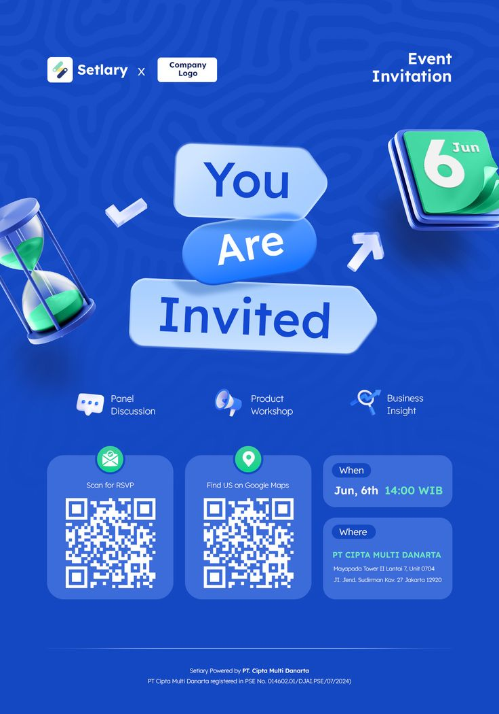

# Blue invitation with frosted arrow-tag 'You Are Invited', 3D hourglass, calendar and QR cards

**Discipline:** print-social · **Design type:** Event flyer
**Tags:** event, invitation, royal-blue, 3d-icons, glass-tags, qr-code, maze-pattern, business

## What it is
A royal blue portrait with a subtle maze pattern, logos at top, three frosted arrow-shaped tags stacking 'You Are Invited', 3D icons (hourglass with green sand, green calendar '6 Jun', check, arrow), three feature icons, two QR cards (RSVP, maps) and two info cards (When, Where).

## What it means
Clear and modern; glass tags and 3D icons make a corporate invite feel light.

## Techniques
- Stack the headline on frosted directional tags.
- Use glossy 3D icons as event motifs.
- Group logistics into rounded cards.
- Give QR codes their own cards.

## Best for
- Corporate event invitations
- Blue and green tech events
- QR-driven flyers

## Vocabulary
- **Glass tag** — A frosted arrow-shaped label.
- **3D icon** — A glossy rendered pictogram.
- **QR card** — A card containing a scan code and label.
- **Info card** — A rounded card with when or where.
