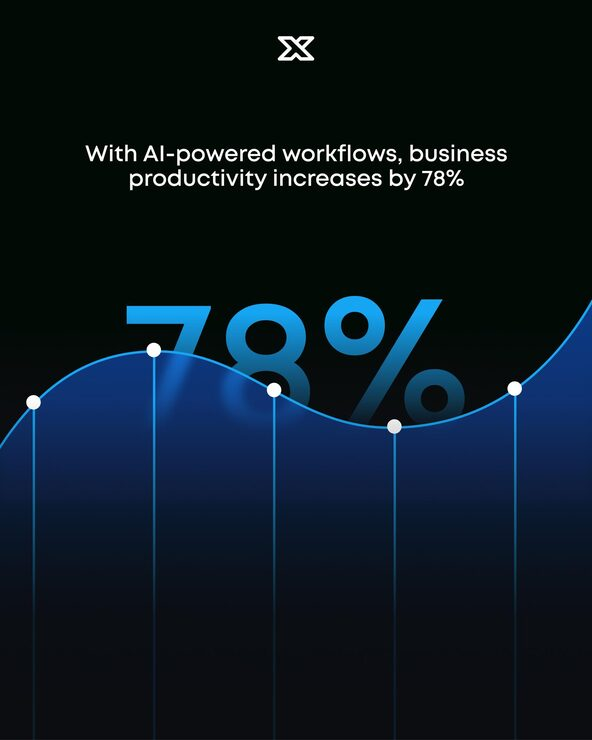

# 'Productivity increases by 78%' post with a glowing blue line chart crossing a huge numeral

**Discipline:** print-social · **Design type:** Social educational post · **Design style:** Dark & Neon
**Tags:** stats, ai, blue, chart, numeral, dark

## What it is
A portrait black post with a white X logo, a single centred sentence, a huge blue '78%' partly hidden behind a glowing blue wave line chart with white data points and vertical drop lines, and a blue gradient fill below.

## What it means
Data-driven and dramatic; the chart literally rises through the stat.

## Techniques
- Let a line chart overlap a giant numeral.
- Mark data points with white dots and drop lines.
- Fill under the curve with a gradient.
- Keep the text to one sentence.

## Best for
- Statistic posts
- AI productivity claims
- Data storytelling

## Vocabulary
- **Drop line** — A vertical line from a data point to the baseline.
- **Hero stat** — A single number shown very large.
