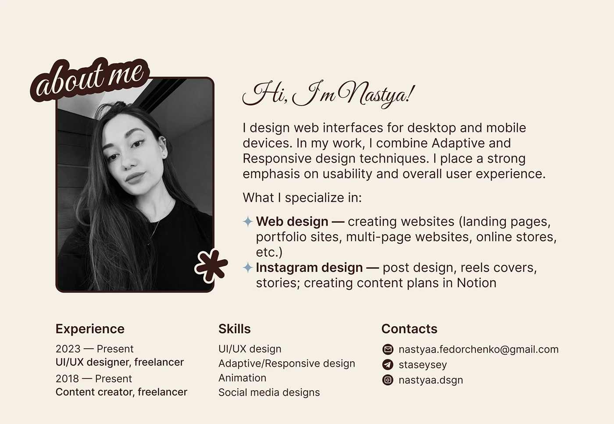

# About-me slide with script greeting, sticker title and greyscale portrait

**Discipline:** print-social · **Design type:** Presentation slides
**Tags:** about-me, presentation, cream, brown, script, sticker, greyscale-portrait, resume

## What it is
A cream slide with dark chocolate text. A rounded greyscale portrait has a bubbly 'about me' sticker label overlapping its corner and an asterisk sticker. To the right a flowing script greeting, a paragraph, and star-bulleted specialisations; below are three columns for Experience, Skills and Contacts with icon bullets.

## What it means
Warm, personal and organised, like a well-designed CV page.

## Techniques
- Use a script font for the greeting and a clean sans for information.
- Overlap a sticker-style label with a portrait corner.
- Use one dark brown on cream for the whole palette.
- Organise details in three tidy columns at the base.

## Best for
- Designer intro and CV slides
- Freelance portfolios
- Personal brand decks

## Vocabulary
- **Sticker label** — A bubbly title with outline placed like a sticker.
- **Script greeting** — A handwritten-style hello.
- **Three-column footer** — A base row splitting info into equal columns.
- **Diamond bullet** — A four-point star used as a list marker.
