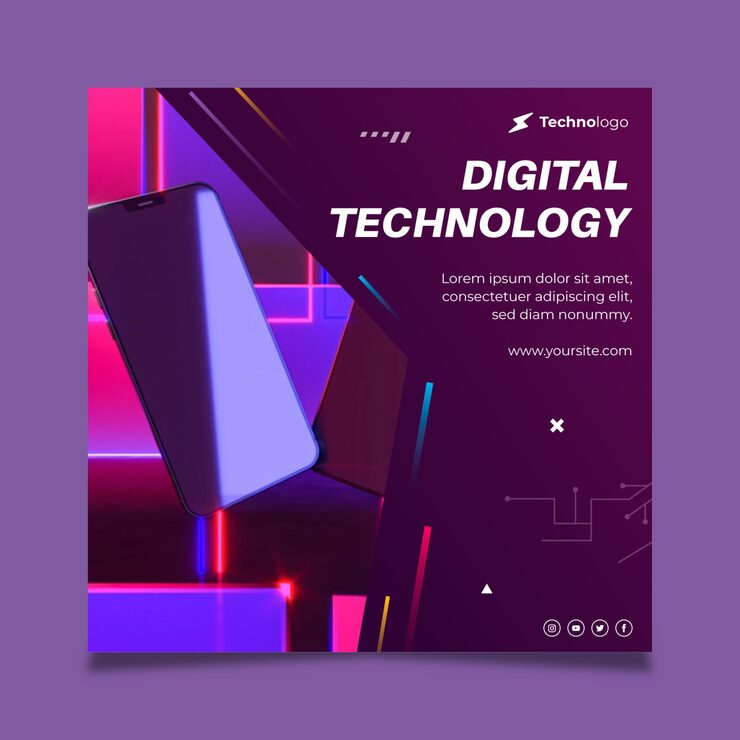

# Purple digital-technology ad with neon geometric planes

**Discipline:** print-social · **Design type:** Social ad · **Design style:** Dark & Neon
**Tags:** social ad, phone product, purple neon, geometric planes, tech

## What it is
A square digital-technology ad on a deep purple background, with a tilted phone floating amid overlapping neon-outlined geometric planes and pink/blue glow accents.

## What it means
Overlapping semi-transparent neon planes behind the product suggest depth and digital energy without needing a busy background photo.

## Techniques
- layer several overlapping semi-transparent geometric planes at different angles for depth
- edge geometric shapes with thin neon outline strokes rather than solid fills
- tilt the hero product diagonally to break the grid formed by the background planes

## Best for
- tech product launch ads
- dark-mode gadget marketing
- futuristic brand campaigns

## Vocabulary
- **geometric plane** — a flat 2D shape used in layered compositions to imply depth or structure without full 3D rendering
