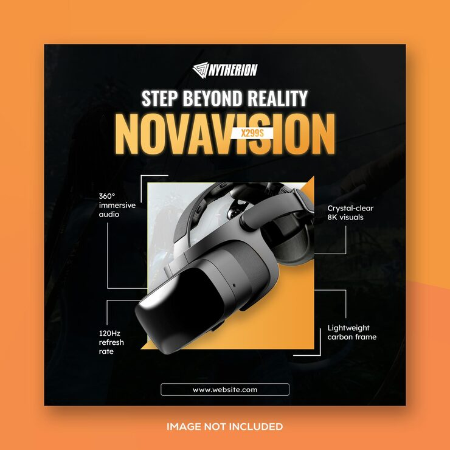

# Orange VR headset ad with dotted spec callout lines

**Discipline:** print-social · **Design type:** Social ad · **Design style:** Corporate & Clean-Tech
**Tags:** social ad, vr headset, orange, spec callouts, product photo

## What it is
A square product ad on an orange gradient background, featuring a dramatic close-up VR headset photo with thin white dotted lines pointing to four spec callouts (audio, visuals, refresh rate, frame weight).

## What it means
Dotted callout lines pointing from specific product parts to labeled specs let a single hero photo double as a mini spec sheet, common in premium tech advertising.

## Techniques
- point thin dotted leader lines from specific product details to surrounding spec labels
- angle the hero product diagonally across the frame for dynamic energy
- use a warm gradient background to contrast against a cool-toned metallic product

## Best for
- gadget/VR product launch ads
- premium tech e-commerce marketing
- spec-forward product advertising

## Vocabulary
- **leader line** — a thin line connecting a label to the specific part of an image it describes
