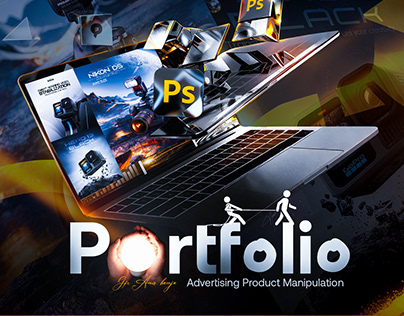

# 'Portfolio — Advertising Product Manipulation' cover with a laptop, camera ads and flying Photoshop icons

**Discipline:** print-social · **Design type:** Brand campaign visual · **Design style:** 3D & Surreal
**Tags:** portfolio, photoshop, manipulation, camera, dark, cover

## What it is
A dark cinematic cover with an open laptop showing Nikon camera ads, chrome Photoshop icon cubes and screens flying out, a large 'Portfolio' title where the 'o' is a glowing bulb, tiny stick figures pulling a rope across the title, and a subtitle.

## What it means
Showy and energetic; exploding assets advertise the designer's compositing skill.

## Techniques
- Explode work samples out of a laptop screen.
- Replace a letter with a glowing object.
- Add tiny figures interacting with the type.

## Best for
- Designer portfolio covers
- Advertising showreels
- Compositing work

## Vocabulary
- **Manipulation** — Photo compositing that combines several images.
- **Scale play** — Tiny figures beside huge objects for surprise.
