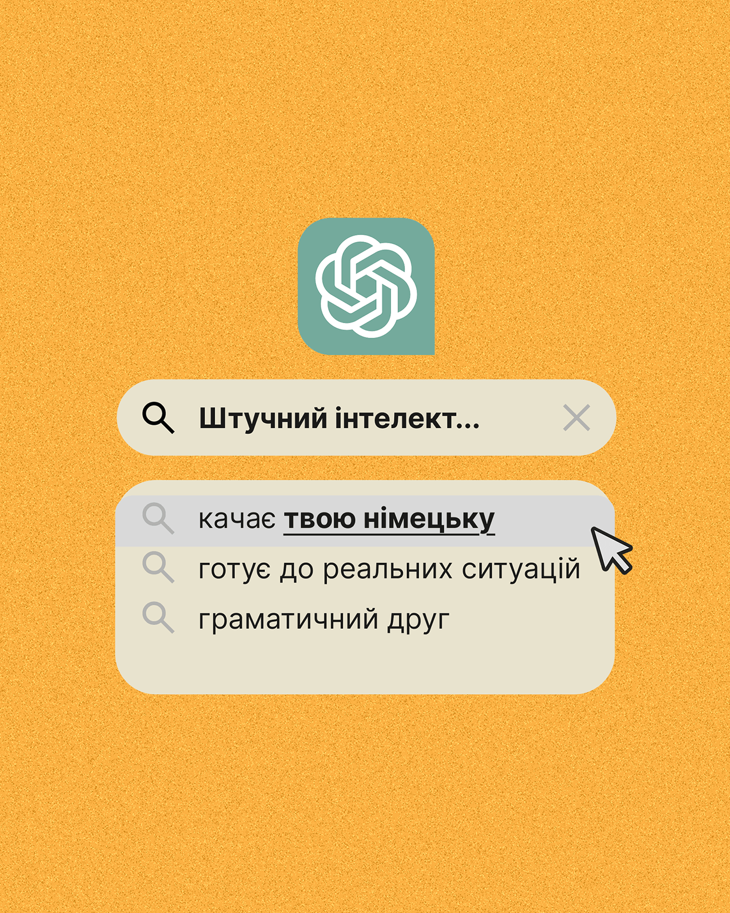

# Mustard grain post with an AI logo tile, search bar and autocomplete list with a cursor

**Discipline:** print-social ·  · **Design style:** Retro & Pixel
**Tags:** ai, search-bar, autocomplete, mustard, grain, ui-parody, cursor, cyrillic

## What it is
A grainy mustard portrait with a green rounded-square AI logo, a cream search field 'Штучний інтелект...' with a clear icon, and an autocomplete dropdown with three suggestions where the first is highlighted grey with bold underlined words and a cursor pointing at it.

## What it means
Simple and instantly readable; the search UI makes the benefits feel like suggestions.

## Techniques
- Use a search bar and autocomplete as the layout.
- Highlight the chosen suggestion.
- Add an oversized logo tile above.
- Keep only cream, mustard and one green.

## Best for
- Tool and tip posts
- UI-parody education posts
- Minimal graphic posts

## Vocabulary
- **Autocomplete list** — Suggested search completions below a field.
- **Selected suggestion** — The highlighted row in a list.
- **Logo tile** — A rounded square holding a logo.
- **Grain field** — A flat colour with fine noise.
