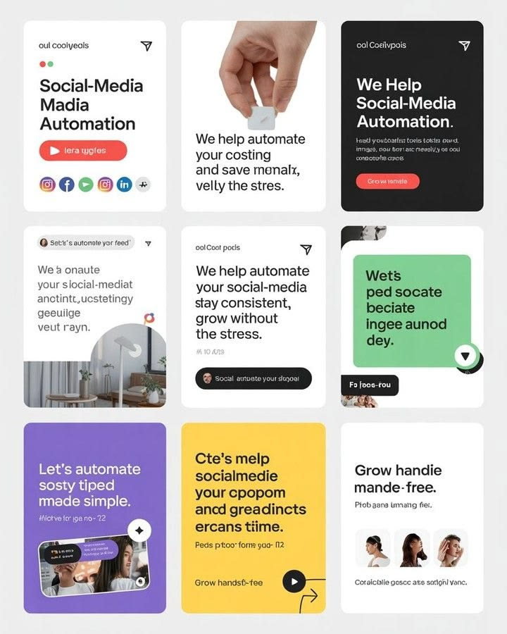

# Social Media Automation Post Grid

**Discipline:** print-social ·  · **Design style:** Corporate & Clean-Tech
**Tags:** templates, grid, white, black, green, purple, yellow, automation

## What it is
A pale grey board of nine portrait posts about social media automation in white, black, green, purple and yellow cards with bold sans headlines, icon rows, buttons, photos and play buttons.

## What it means
Alternating flat colour cards with the same type system make a feed feel varied yet consistent.

## Techniques
- Flat colour backgrounds rotated across cards
- Bold left-aligned headlines
- Black pill buttons and round play icons
- Cut photos in rounded corners
- Small brand row at each card top

## Best for
- Tech and SaaS social feeds
- Template pack previews
- Colour-rotation grid concepts

## Vocabulary
- **Colour rotation** — Cycling background colours across a set of posts.
- **Feed grid** — A 3-by-3 arrangement of posts.
- **Play button** — A round icon signalling video.
