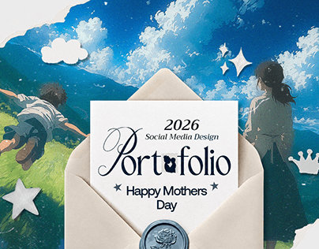

# Painted anime sky and meadow cover with a cream envelope card, wax seal and paper stickers

**Discipline:** print-social · **Design type:** Presentation slides
**Tags:** portfolio, cover, anime, sky, envelope, wax-seal, paper-cutouts, serif-script

## What it is
A painterly sky with a child flying above a meadow at left and a woman at right, torn paper edges, white paper cloud, star and crown stickers, and a cream envelope holding a card with '2026 Social Media Design', a flourished serif 'Portfolio' and 'Happy Mothers Day', sealed with a blue wax stamp.

## What it means
Tender and whimsical; the envelope frames the title like a letter.

## Techniques
- Use a painted illustration as backdrop.
- Place the title on an envelope card with wax seal.
- Add paper cutout stickers.
- Mix serif and script in the title.

## Best for
- Seasonal and gift-themed portfolio covers
- Emotional social campaigns
- Illustration-backed decks

## Vocabulary
- **Envelope card** — A card peeking from an envelope.
- **Wax seal** — A stamped wax circle sealing a letter.
- **Paper cutout sticker** — A white paper-cut shape.
- **Painted backdrop** — An illustrated background.
