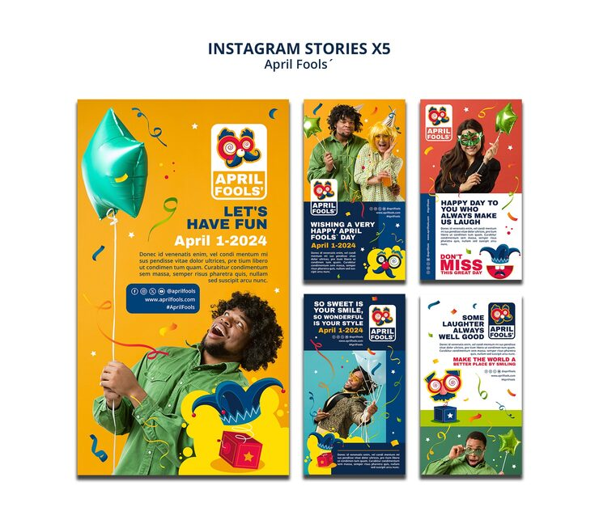

# April Fools' Instagram story set with an orange jester mascot, balloon and laughing man photos

**Discipline:** print-social · **Design type:** Story set · **Design style:** Playful & Illustrated
**Tags:** april-fools, stories, orange, jester, mascot, photo

## What it is
Five vertical story cards in orange, red, blue and green with a jester-mask logo, photos of a laughing man in green holding a teal heart balloon and party horns, headlines like 'Let's Have Fun' and 'So Sweet is Your Smile', and confetti scattered throughout.

## What it means
Warm and festive; a recurring jester mascot logo ties five differently coloured cards into one campaign.

## Techniques
- Anchor a multi-colour card set with one consistent mascot logo.
- Mix real photography with illustrated props like balloons and confetti.
- Vary background colour per card while keeping typography fixed.

## Best for
- Holiday and novelty campaigns
- Instagram story sets
- Event promotion

## Vocabulary
- **Mascot logo** — A small character-based logo used as a recurring brand marker.
- **Story set** — A group of vertical social posts designed to be viewed in sequence.
