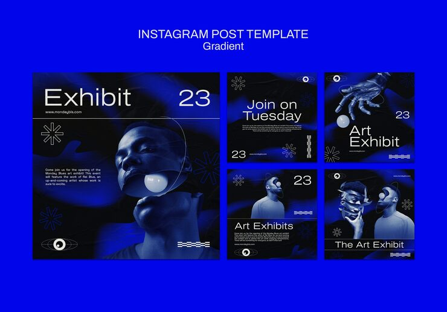

# 'Art Exhibit' posts in deep cobalt with a duotone portrait, glass orb prop and sparkle line icons

**Discipline:** print-social · **Design type:** Social template pack · **Design style:** Gradient & Aurora
**Tags:** art-exhibit, cobalt, duotone, glass-orb, sparkle, instagram

## What it is
Five deep-blue square posts with a duotone photo of a person holding a glowing glass orb near their face, bold white headlines ('Exhibit 23', 'Join on Tuesday', 'Art Exhibit'), sparkle asterisk and eye line icons, wavy line graphics and event details.

## What it means
Moody and artistic; the glowing orb prop and duotone photography give a gallery announcement real visual intrigue.

## Techniques
- Duotone a portrait in one deep saturated colour.
- Use a glowing prop (orb) as a recurring surreal touch.
- Scatter small line icons (sparkle, eye) as gallery-style ornamentation.

## Best for
- Art gallery and exhibit promotion
- Moody duotone branding
- Creative event marketing

## Vocabulary
- **Duotone portrait** — A photo of a person rendered in only two colours.
- **Glass orb prop** — A translucent sphere used as a surreal photography prop.
