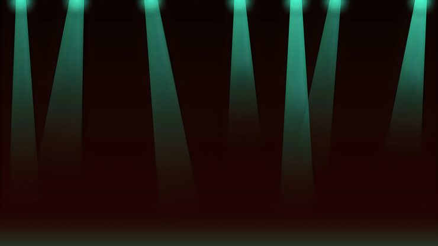

# Teal spotlight beam stage background

**Discipline:** print-social · **Design type:** Background pattern · **Design style:** Dark & Neon
**Tags:** background, spotlight, teal, dark, stage, concert

## What it is
A dark auditorium background photo showing teal-colored spotlight beams shining down through haze against a near-black backdrop.

## What it means
A moody lit-beam background provides instant atmosphere and depth for event marketing without needing any subject in frame, leaving space for text or product overlays.

## Techniques
- photograph light beams through haze/fog to add volumetric depth to a dark background
- keep the entire composition in a narrow dark-to-teal tonal range for mood
- leave the lower two-thirds emptier of detail to reserve space for overlaid text

## Best for
- concert/event promotional backgrounds
- dark-mode website hero backgrounds
- dramatic overlay-ready textures

## Vocabulary
- **volumetric lighting** — visible light rays scattered through a medium like fog or dust, adding a sense of depth and atmosphere
