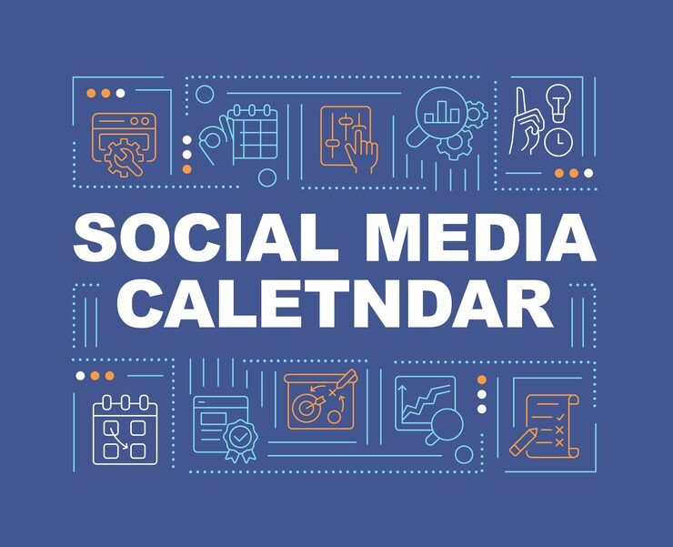

# Navy banner with dashed-outline icon rows framing a headline

**Discipline:** print-social · **Design type:** Social banner · **Design style:** Corporate & Clean-Tech
**Tags:** banner, navy, dashed border, icon row, headline, orange accent

## What it is
A wide navy banner with a huge centered headline, flanked above and below by rows of five dashed-outline icon boxes representing planning-related concepts.

## What it means
Framing bold type between symmetric icon rows gives a text-only headline extra visual structure and implies a fuller feature set without adding real complexity.

## Techniques
- frame a large centered headline with symmetric rows of small icon tiles above and below
- use dashed/dotted outline strokes on icons for a lighter, technical feel than solid fills
- limit accent colors to small dot details so the navy/white/orange palette stays disciplined

## Best for
- SaaS/productivity brand banners
- content calendar or planning tool marketing
- LinkedIn/blog header graphics

## Vocabulary
- **icon row** — a horizontal series of small pictograms used to suggest a feature set or process steps
