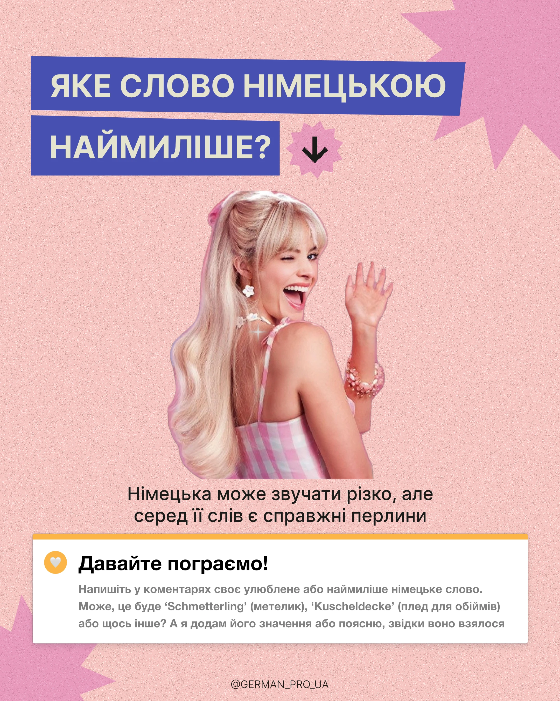

# Peach grain post with blue banner question, starbursts, a pink-dressed cutout and a white comment card

**Discipline:** print-social · **Design type:** Social educational post
**Tags:** language, peach, blue-banners, starburst, cutout, comment-card, yellow-edge, cyrillic

## What it is
A grainy peach post with two slanted blue banners with cream caps, a pink starburst with an arrow, large lilac starbursts at the edges, a cutout of a winking woman in a pink gingham top and a white card with a yellow top edge, a heart icon and text inviting comments.

## What it means
Cheerful and interactive; the comment card turns the post into a game.

## Techniques
- Use slanted blue banners for the question.
- Cut out a personality figure.
- End with a white interaction card with a coloured edge.
- Add starburst accents.

## Best for
- Language engagement posts
- Comment-prompt carousels
- Pink and blue palettes

## Vocabulary
- **Comment card** — A white card prompting replies.
- **Starburst accent** — A spiky shape used as decoration.
- **Slanted banner** — A title strip with angled ends.
- **Personality cutout** — A cutout of a recognisable person.
